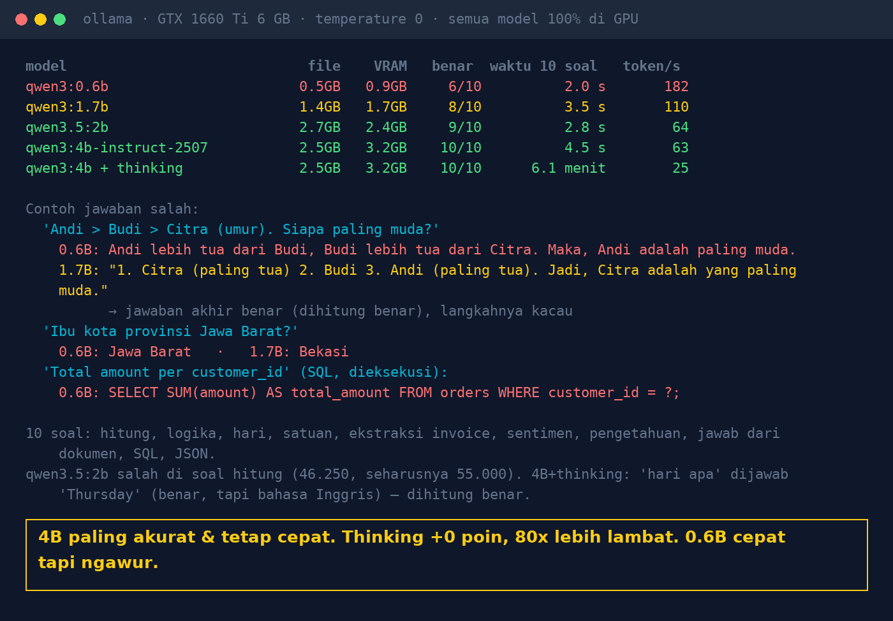

# Lab 04 — 0.6B, 1.7B, 2B, or 4B: How "Big" an AI Do You Need?

**Language:** [Bahasa Indonesia](README.md) · English

Ten questions with exact answers, graded automatically (SQL is even executed against SQLite), run
against several model sizes. Measured: number correct, time, tokens/second, file size, and GPU memory.

## Extra models

```bash
ollama pull qwen3:0.6b    # 0.5 GB
ollama pull qwen3:1.7b    # 1.4 GB
```

Every model in this lab fits on a 6 GB GPU (at most ±3.2 GB VRAM).

## Run it

```bash
python 04-ukuran-model/run.py
VERBOSE=1 python 04-ukuran-model/run.py                # show every answer
MODELS="qwen3:1.7b,qwen3:4b" python 04-ukuran-model/run.py
```

## The 10 questions

shopping arithmetic · age-ordering logic · day of the week · unit conversion · invoice total
extraction · sentiment · general knowledge (provincial capital) · answering from a document · SQL
(executed, result compared) · JSON (parsed, content compared). Details & grading rules are in `TASKS`
in `run.py` (questions are in Indonesian).

## Our results (30 Oct 2026, GTX 1660 Ti 6 GB, temperature 0, all models 100% on GPU)

| Model | File | VRAM | Correct | Time for 10 | Tokens/s |
|---|---|---|---|---|---|
| qwen3:0.6b | 0.5 GB | 0.9 GB | 6/10 | 2.0 s | 182 |
| qwen3:1.7b | 1.4 GB | 1.7 GB | 8/10 | 3.5 s | 110 |
| qwen3.5:2b | 2.7 GB | 2.4 GB | 9/10 | 2.8 s | 64 |
| qwen3:4b-instruct-2507 | 2.5 GB | 3.2 GB | 10/10 | 4.5 s | 63 |
| qwen3:4b + thinking | 2.5 GB | 3.2 GB | 10/10 | ±6 minutes | 25 |



Grading notes: the 1.7B answer to the logic question had muddled steps ("Citra (oldest) … Andi
(oldest)") but a correct final conclusion, so it was counted correct. 4B+thinking answered
"Thursday" (correct, in English) and was counted correct.

## Lessons

1. Bigger isn't always needed: for narrow tasks (extraction, classification, JSON) a small model is
   often enough.
2. Very small models are fast but "sloppy" at logic & knowledge; don't use them to answer facts.
3. Thinking mode isn't free: in this test it added no score but was ±80x slower.
4. Measure with questions from your own work, not general benchmarks.
5. Check VRAM: a model that doesn't fit entirely on the GPU is partly moved to the CPU and becomes much
   slower.
