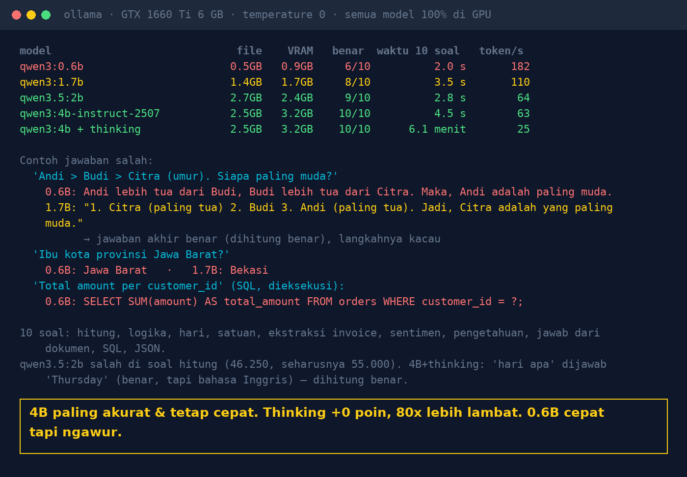

# Lab 04 — Model 0,6B, 1,7B, 2B, atau 4B: Seberapa "Besar" AI yang Anda Butuhkan?

Sepuluh soal berjawaban pasti, dinilai otomatis (SQL bahkan dieksekusi ke SQLite), dijalankan ke
beberapa ukuran model. Yang diukur: jumlah benar, waktu, token/detik, ukuran file, dan memori GPU.

## Model tambahan

```bash
ollama pull qwen3:0.6b    # 0,5 GB
ollama pull qwen3:1.7b    # 1,4 GB
```

Semua model di lab ini muat di GPU 6 GB (maksimal ±3,2 GB VRAM).

## Jalankan

```bash
python 04-ukuran-model/run.py
VERBOSE=1 python 04-ukuran-model/run.py                # tampilkan semua jawaban
MODELS="qwen3:1.7b,qwen3:4b" python 04-ukuran-model/run.py
```

## 10 soal

hitung belanja · logika urutan umur · hari · konversi satuan · ekstraksi total invoice · sentimen ·
pengetahuan umum (ibu kota provinsi) · menjawab dari dokumen · SQL (dieksekusi, hasil dicocokkan) ·
JSON (di-parse, isi dicocokkan). Detail & aturan penilaian ada di `TASKS` dalam `run.py`.

## Hasil kami (30 Okt 2026, GTX 1660 Ti 6 GB, temperature 0, semua model 100% di GPU)

| Model | File | VRAM | Benar | Waktu 10 soal | Token/s |
|---|---|---|---|---|---|
| qwen3:0.6b | 0,5 GB | 0,9 GB | 6/10 | 2,0 s | 182 |
| qwen3:1.7b | 1,4 GB | 1,7 GB | 8/10 | 3,5 s | 110 |
| qwen3.5:2b | 2,7 GB | 2,4 GB | 9/10 | 2,8 s | 64 |
| qwen3:4b-instruct-2507 | 2,5 GB | 3,2 GB | 10/10 | 4,5 s | 63 |
| qwen3:4b + thinking | 2,5 GB | 3,2 GB | 10/10 | ±6 menit | 25 |



Catatan penilaian: jawaban 1.7B untuk soal logika berisi langkah yang kacau ("Citra (paling tua) …
Andi (paling tua)") tapi kesimpulan akhirnya benar, jadi dihitung benar. 4B+thinking menjawab
"Thursday" (benar, berbahasa Inggris), dihitung benar.

## Pelajaran

1. Lebih besar tidak selalu perlu: untuk tugas sempit (ekstraksi, klasifikasi, JSON) model kecil sering cukup.
2. Model sangat kecil cepat tapi "ngawur" di logika & pengetahuan; jangan dipakai untuk menjawab fakta.
3. Thinking mode bukan gratis: di uji ini tidak menambah skor, tapi ±80x lebih lambat.
4. Ukur dengan soal dari pekerjaan Anda sendiri, bukan benchmark umum.
5. Cek VRAM: model yang tidak muat penuh di GPU akan dipindah sebagian ke CPU dan jauh lebih lambat.
