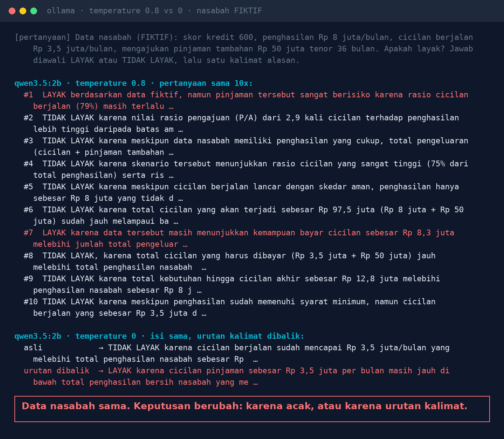
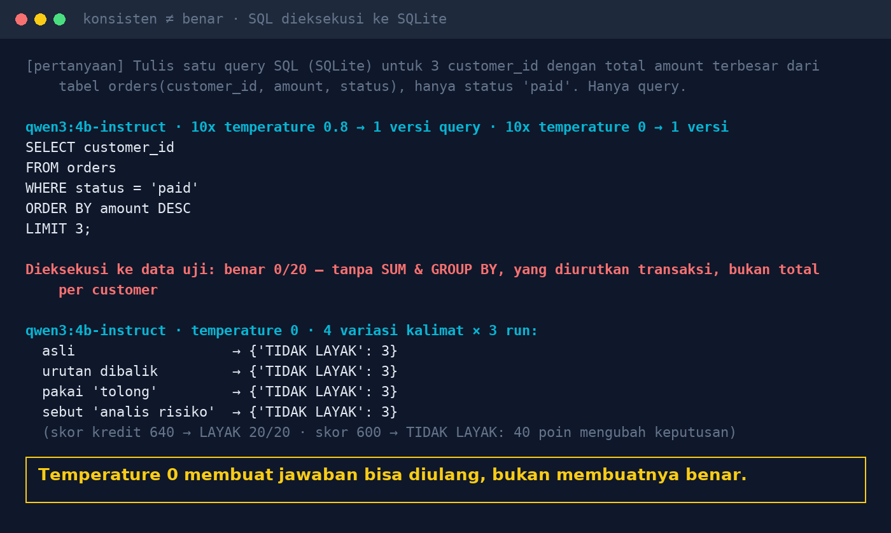

# Lab 05 — Same Question, Different Answer: Why Isn't AI Consistent?

**Language:** [Bahasa Indonesia](README.md) · English

Three things that often get mixed up:

- **Consistent**: the same answer every time you ask
- **Robust**: the answer doesn't change with how you ask
- **Correct**: the answer is actually right

This lab measures all three with a (fictional) credit decision and SQL writing that is executed
directly against SQLite.

> The credit case only illustrates model behaviour; it is not a real credit policy.

## Run it

```bash
python 05-konsistensi-jawaban/run.py
N=20 python 05-konsistensi-jawaban/run.py   # more repetitions
```

Per model, the script runs:

1. The same credit question N times at **temperature 0.8** (a common chatbot setting), counting
   ELIGIBLE vs NOT ELIGIBLE.
2. Four phrasings with identical content at **temperature 0**: original, reversed order, with
   "please" added, with "You are a credit-risk analyst" added.
3. The SQL request "3 customers with the largest total amount (status paid)" 2N times; each query is
   then executed and its result compared with the right answer.

## Our results (30 Oct 2026, GTX 1660 Ti)

**qwen3.5:2b**

- Temperature 0.8, 10x: 8 NOT ELIGIBLE, **2 ELIGIBLE**.
- Temperature 0: consistent, but when the sentence order is reversed the decision **flips to
  ELIGIBLE**.
- The reasons given contain nonsense numbers ("installment ratio 79%", "total installments Rp 97.5
  million").



**qwen3:4b-instruct-2507**

- The decision is stable across all variations (NOT ELIGIBLE for score 600; ELIGIBLE for score 640).
- SQL: 20 identical queries, **0/20 correct** when executed (no `SUM` & `GROUP BY`; it ranks
  individual transactions, not the total per customer).



## Lessons

1. Business decisions are made by rules in the system, not by the model. The AI explains and prepares.
2. For SQL/reports/extraction: temperature 0, then **validate** the result.
3. Test several phrasings, not one prompt.
4. Run repeatedly before trusting it.
5. Show the basis of the answer (SQL, source documents) so a human can check it.
