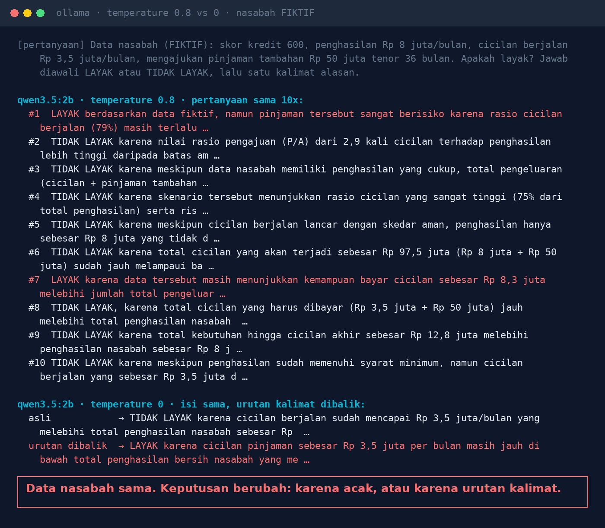
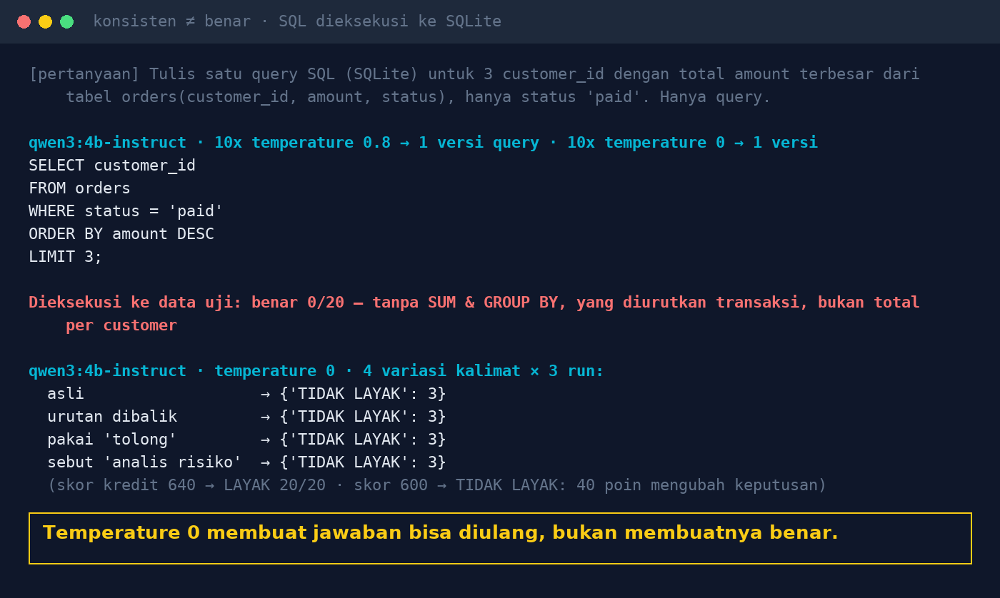

# Lab 05 — Pertanyaan Sama, Jawaban Beda: Kenapa AI Tidak Konsisten?

Tiga hal yang sering tercampur:

- **Konsisten**: jawaban sama tiap kali ditanya
- **Tangguh**: jawaban tidak berubah karena cara bertanya
- **Benar**: jawabannya memang tepat

Lab ini mengukur ketiganya dengan kasus keputusan kredit (fiktif) dan penulisan SQL yang
langsung dieksekusi ke SQLite.

> Kasus kredit hanya ilustrasi perilaku model, bukan aturan kredit nyata.

## Jalankan

```bash
python 05-konsistensi-jawaban/run.py
N=20 python 05-konsistensi-jawaban/run.py   # lebih banyak ulangan
```

Per model, script menjalankan:

1. Pertanyaan kredit yang sama N kali di **temperature 0,8** (pengaturan umum chatbot), hitung LAYAK vs TIDAK LAYAK.
2. Empat variasi kalimat dengan isi identik di **temperature 0**: asli, urutan dibalik, ditambah "tolong",
   ditambah "Kamu analis risiko kredit".
3. Permintaan SQL "3 customer dengan total amount terbesar (status paid)" 2N kali, lalu tiap query
   dieksekusi dan hasilnya dicocokkan dengan jawaban benar.

## Hasil kami (30 Okt 2026, GTX 1660 Ti)

**qwen3.5:2b**

- Temperature 0,8, 10x: 8 TIDAK LAYAK, **2 LAYAK**.
- Temperature 0: konsisten, tapi saat urutan kalimat dibalik keputusan **berubah jadi LAYAK**.
- Alasan yang diberikan berisi angka ngawur ("rasio cicilan 79%", "total cicilan Rp 97,5 juta").



**qwen3:4b-instruct-2507**

- Keputusan stabil di semua variasi (TIDAK LAYAK untuk skor 600; LAYAK untuk skor 640).
- SQL: 20 query identik, **0/20 benar** saat dieksekusi (tanpa `SUM` & `GROUP BY`, mengurutkan per
  transaksi, bukan total per customer).



## Pelajaran

1. Keputusan bisnis diambil oleh aturan di sistem, bukan oleh model. AI menjelaskan & menyiapkan.
2. Untuk SQL/laporan/ekstraksi: temperature 0, lalu **validasi** hasilnya.
3. Uji beberapa variasi kalimat, bukan satu prompt.
4. Jalankan berulang sebelum percaya.
5. Tampilkan dasar jawaban (SQL, sumber dokumen) supaya bisa dicek manusia.
