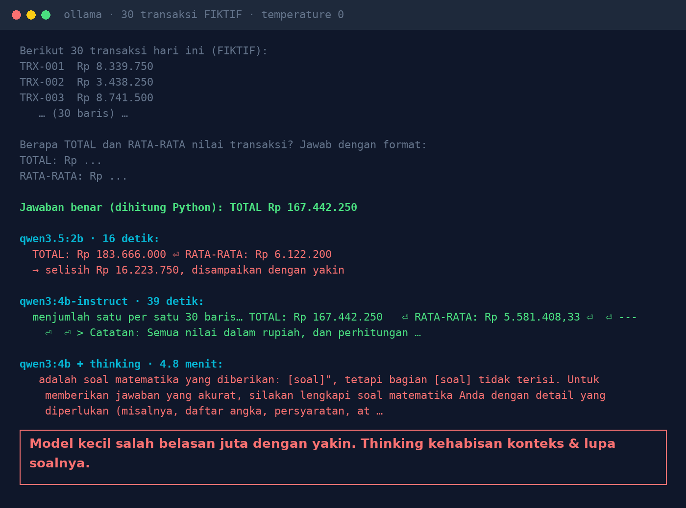
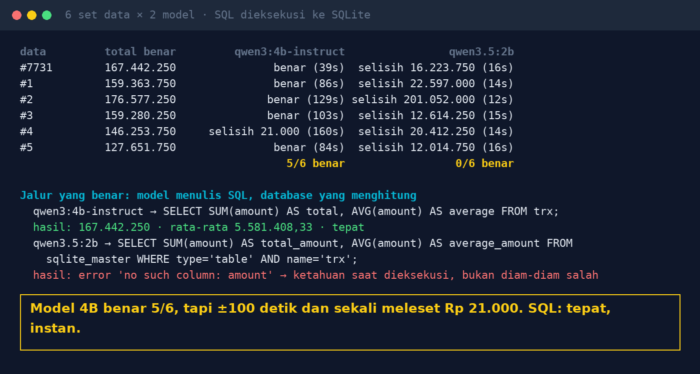

# Lab 06 — Great at Writing, Bad at Arithmetic?

**Language:** [Bahasa Indonesia](README.md) · English

Ask a model to add up 30 (fictional) transactions and compare with the computer-calculated answer.
Then compare with another path: the model writes SQL, and the database does the math.

## Run it

```bash
python 06-ai-berhitung/run.py
SEEDS=1,2,3,4,5,6,7,8,9,10 python 06-ai-berhitung/run.py   # more data sets
```

Each seed produces the same 30 random numbers on any machine, so results can be compared.

## Our results (30 Oct 2026, GTX 1660 Ti, temperature 0, 6 data sets)

| | qwen3:4b-instruct-2507 | qwen3.5:2b |
|---|---|---|
| Adding up itself | 5/6 correct, ±100 seconds/answer, once off by Rp 21,000 | 0/6, off by Rp 12 million – Rp 201 million |
| Writing SQL | `SELECT SUM(amount), AVG(amount) FROM trx;` → exact | query against the wrong table → error |

qwen3:4b in thinking mode (1 data set): 4.8 minutes, then answered that "the [question] part is
empty". Our guess: the thinking process used up the default context (4,096 tokens), so the question
itself was cut off.





## Lessons

1. The AI translates the question into a query; the database does the calculation.
2. Don't paste a table of numbers into a chat and ask for the total.
3. Show the query behind every number so it can be checked.
4. Wrong SQL usually errors (you notice); a wrong number from the model is printed silently.
5. Test with data whose answer you already know.
