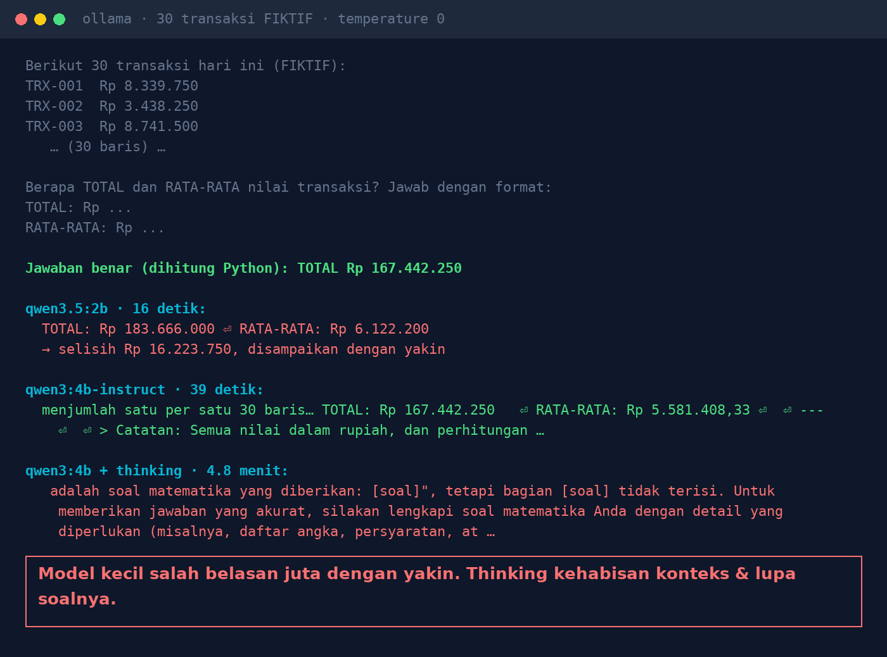
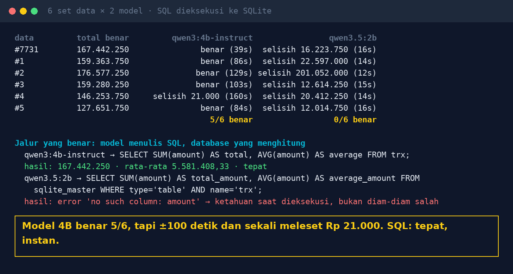

# Lab 06 — AI Pintar Menulis, Payah Berhitung?

Minta model menjumlah 30 transaksi (fiktif), bandingkan dengan jawaban yang dihitung komputer.
Lalu bandingkan dengan jalur lain: model menulis SQL, database yang menghitung.

## Jalankan

```bash
python 06-ai-berhitung/run.py
SEEDS=1,2,3,4,5,6,7,8,9,10 python 06-ai-berhitung/run.py   # lebih banyak set data
```

Tiap seed menghasilkan 30 angka acak yang sama persis di mesin mana pun, jadi hasilnya bisa
dibandingkan.

## Hasil kami (30 Okt 2026, GTX 1660 Ti, temperature 0, 6 set data)

| | qwen3:4b-instruct-2507 | qwen3.5:2b |
|---|---|---|
| Menjumlah sendiri | 5/6 benar, ±100 detik/jawaban, sekali meleset Rp 21.000 | 0/6, selisih Rp 12 juta – Rp 201 juta |
| Menulis SQL | `SELECT SUM(amount), AVG(amount) FROM trx;` → tepat | query ke tabel yang salah → error |

qwen3:4b dengan mode thinking (1 set data): 4,8 menit, lalu menjawab "bagian [soal] tidak terisi".
Dugaan kami: proses thinking menghabiskan konteks default (4.096 token) sehingga soalnya ikut terpotong.





## Pelajaran

1. AI menerjemahkan pertanyaan jadi query; database yang menghitung.
2. Jangan tempel tabel angka ke chat lalu minta totalnya.
3. Tampilkan query di balik setiap angka supaya bisa dicek.
4. SQL yang salah biasanya error (ketahuan); angka yang salah dari model tercetak diam-diam.
5. Uji dengan data yang jawabannya sudah Anda tahu.
