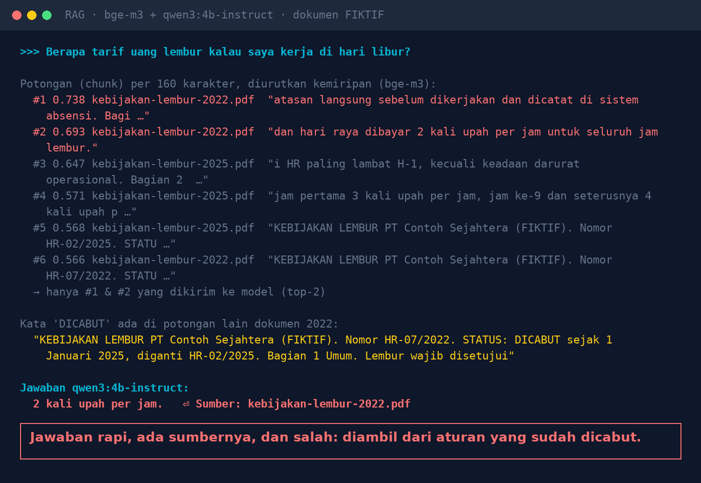
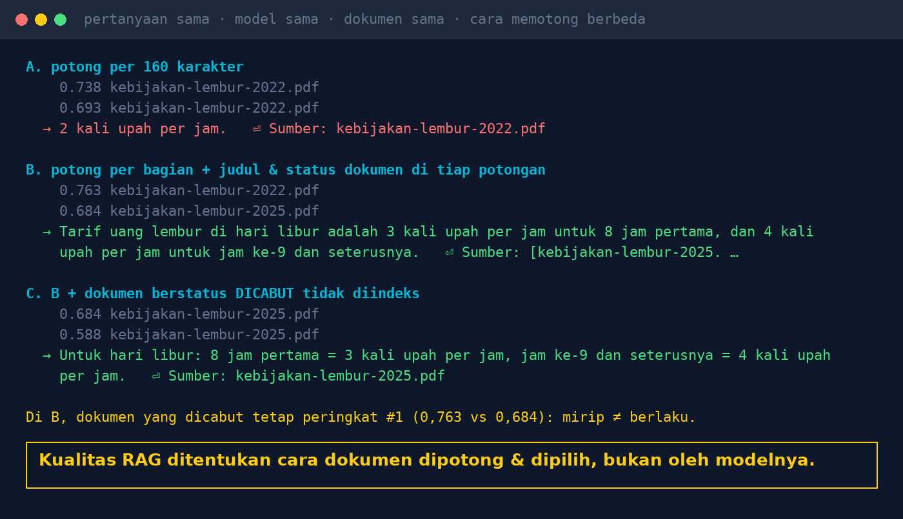

# Lab 07 — The Document Is There, the Answer Is Still Wrong: RAG Failures Rarely Discussed

**Language:** [Bahasa Indonesia](README.md) · English

A document chatbot (RAG) works in three steps: split the documents → find the chunks most "similar"
to the question → send the top few chunks to the model. This lab shows how the first and second
steps can produce a wrong answer, even though the model does not hallucinate.

Three **fictional** policy documents: the 2022 overtime policy (**REVOKED**), the 2025 overtime policy
(**IN FORCE**), and the leave policy.

## Extra model

```bash
ollama pull bge-m3:567m   # embedding model, 1.2 GB
```

## Run it

```bash
python 07-rag-salah-ambil/run.py
```

Question (asked in Indonesian): *"What is the overtime rate if I work on a public holiday?"* (correct
answer: 3x hourly wage for the first 8 hours, 4x from the 9th hour on). Three ways of preparing the
chunks:

- **A.** split every 160 characters
- **B.** split per document section, each chunk prefixed with the document's title, number, and status
- **C.** like B, but REVOKED documents are not indexed

## Our results (30 Oct 2026)

| Method | Top 2 chunks | Answer |
|---|---|---|
| A | both from the 2022 document (REVOKED) | **"2 times the hourly wage. Source: kebijakan-lembur-2022.pdf"** — wrong |
| B | 2022 (#1, 0.763) and 2025 (#2, 0.684) | correct, cites the 2025 document |
| C | both from the 2025 document | correct |

In method A, the word "REVOKED" was in another chunk that wasn't selected, and the chunk with the
correct rate was ranked #4.





## Lessons

1. "Similar" is not the same as "in force": in method B, the revoked document was still ranked #1.
2. Remove revoked/expired documents from the index.
3. Split by complete sections, not by character count.
4. Include the title, number, and effective date in every chunk.
5. Show sources with every answer.
6. When an answer is wrong, check the retrieved chunks first, then blame the model.

## Try variations

- Change the chunk size (`chunks_fixed(size=...)`) and the number of chunks (`retrieve(..., k=...)`).
- Add a third, 2026 version of the document that changes the rate again.
