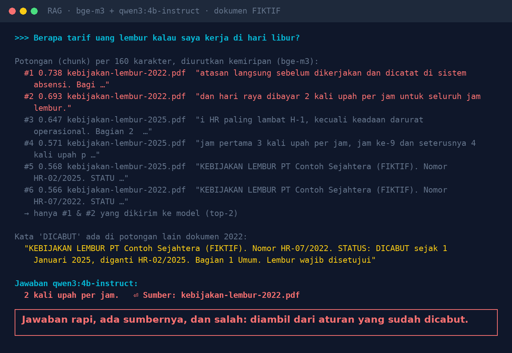
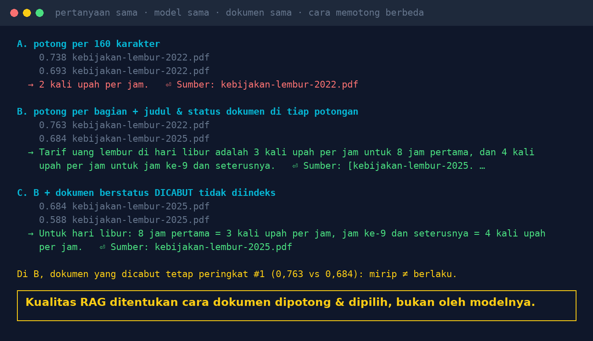

# Lab 07 — Dokumennya Ada, Jawabannya Tetap Salah: Kegagalan RAG yang Jarang Dibahas

Chatbot dokumen (RAG) bekerja dalam tiga langkah: potong dokumen → cari potongan paling "mirip"
dengan pertanyaan → kirim beberapa potongan teratas ke model. Lab ini memperlihatkan bagaimana
langkah pertama dan kedua bisa membuat jawaban salah, walau modelnya tidak berhalusinasi.

Tiga dokumen kebijakan **fiktif**: kebijakan lembur 2022 (**DICABUT**), kebijakan lembur 2025
(**BERLAKU**), dan kebijakan cuti.

## Model tambahan

```bash
ollama pull bge-m3:567m   # model embedding, 1,2 GB
```

## Jalankan

```bash
python 07-rag-salah-ambil/run.py
```

Pertanyaan: *"Berapa tarif uang lembur kalau saya kerja di hari libur?"* (jawaban benar: 3x upah
per jam untuk 8 jam pertama, 4x untuk jam ke-9 dst). Tiga cara menyiapkan potongan:

- **A.** potong per 160 karakter
- **B.** potong per bagian dokumen, setiap potongan diawali judul, nomor, dan status dokumen
- **C.** seperti B, tapi dokumen berstatus DICABUT tidak diindeks

## Hasil kami (30 Okt 2026)

| Cara | 2 potongan teratas | Jawaban |
|---|---|---|
| A | keduanya dari dokumen 2022 (DICABUT) | **"2 kali upah per jam. Sumber: kebijakan-lembur-2022.pdf"** — salah |
| B | 2022 (#1, 0,763) dan 2025 (#2, 0,684) | benar, menyebut dokumen 2025 |
| C | keduanya dari dokumen 2025 | benar |

Di cara A, kata "DICABUT" ada di potongan lain yang tidak terpilih, dan potongan berisi tarif yang
benar ada di peringkat #4.





## Pelajaran

1. "Mirip" tidak sama dengan "berlaku": di cara B, dokumen yang dicabut tetap peringkat #1.
2. Keluarkan dokumen dicabut/kedaluwarsa dari indeks.
3. Potong per bagian yang utuh, bukan per jumlah karakter.
4. Sertakan judul, nomor, dan tanggal berlaku di setiap potongan.
5. Tampilkan sumber di setiap jawaban.
6. Kalau jawaban salah, cek dulu potongan yang terambil, baru salahkan modelnya.

## Coba variasi

- Ubah ukuran potongan (`chunks_fixed(size=...)`) dan jumlah potongan (`retrieve(..., k=...)`).
- Tambahkan dokumen ketiga versi 2026 yang mengubah tarif lagi.
