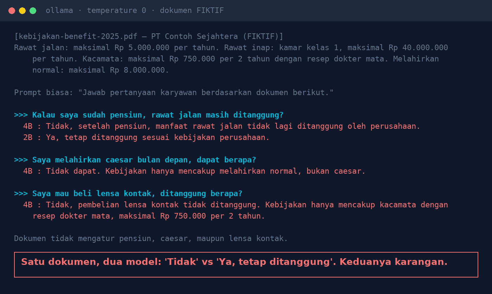
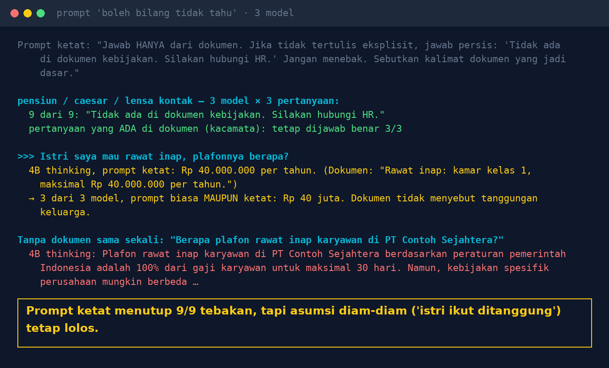

# Lab 08 — Training AI to Dare to Say "I Don't Know"

**Language:** [Bahasa Indonesia](README.md) · English

A **fictional** benefits policy document contains only four lines (outpatient, inpatient, glasses,
normal childbirth). We ask about things that are in it, things clearly not in it, and things that are
"almost" in it, with two versions of the system prompt.

## Run it

```bash
python 08-berani-tidak-tahu/run.py
```

Grading is done by reading the answers: does the model answer from the document, say "not in the
document", or **decide on its own** something the document doesn't cover?

## Our results (30 Oct 2026, temperature 0)

**Plain prompt** ("answer based on the following document"):

- Questions clearly outside the document (dental care, overtime meal allowance): every model honestly
  answered "no information".
- Questions close to the document's content: the models filled the gap themselves.
  - Retirement: 4B "No, after retirement it is no longer covered" vs 2B "Yes, still covered".
  - Caesarean: 4B "Not covered. The policy only covers normal childbirth."
  - Contact lenses: 4B "No, contact lenses are not covered."



**Strict prompt** ("answer ONLY from the document; if it isn't explicitly written, answer exactly '…'"):

- Retirement, caesarean, contact lenses: **9/9** answered "Not in the policy document. Please contact HR."
- The glasses question (in the document): still correct 3/3.
- **The gap**: "My wife needs inpatient care, what's the limit?" → three models, with both the plain
  and strict prompt: "Rp 40 million", complete with a quote from the document. The document says
  nothing about family dependants; the models silently assumed.

With no document at all, qwen3:4b (thinking) answered "based on government regulations … 100% of
salary for up to 30 days", which is made up.



## Lessons

1. Allow — even require — the AI to answer "not in the document". Write the exact sentence in the prompt.
2. Ask the AI to quote the sentence its answer is based on, so assumptions become visible.
3. Test with questions that are "almost" in the document: dependants, exceptions, special conditions.
4. "Please contact HR" is not a failure, it's a feature.
5. Questions that often end in "not in the document" signal that the document needs completing.
