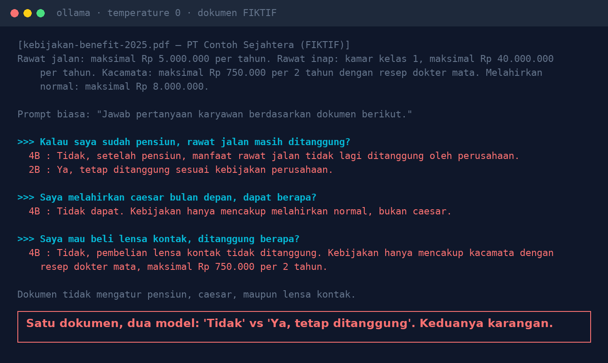
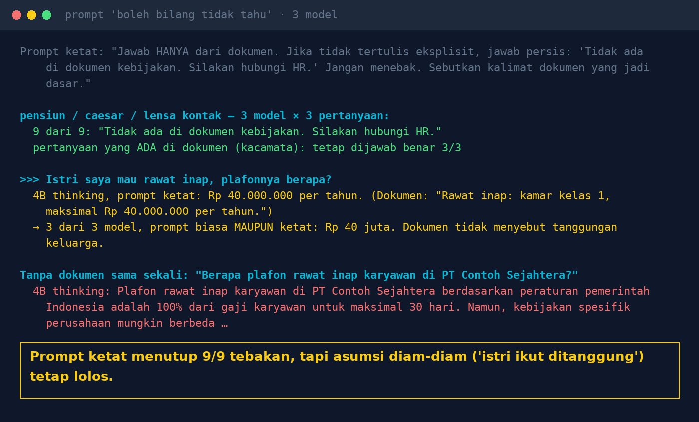

# Lab 08 — Melatih AI Berani Bilang "Saya Tidak Tahu"

Dokumen kebijakan benefit **fiktif** hanya berisi empat baris (rawat jalan, rawat inap, kacamata,
melahirkan normal). Kita bertanya hal yang ada, yang jelas tidak ada, dan yang "hampir" ada, dengan
dua versi prompt sistem.

## Jalankan

```bash
python 08-berani-tidak-tahu/run.py
```

Penilaian dilakukan dengan membaca jawaban: apakah model menjawab dari dokumen, mengatakan "tidak
ada di dokumen", atau **memutuskan sendiri** hal yang tidak diatur.

## Hasil kami (30 Okt 2026, temperature 0)

**Prompt biasa** ("jawab berdasarkan dokumen berikut"):

- Pertanyaan yang jelas di luar dokumen (perawatan gigi, uang makan lembur): semua model jujur
  menjawab "tidak ada informasi".
- Pertanyaan yang dekat dengan isi dokumen: model mengisi celahnya sendiri.
  - Pensiun: 4B "Tidak, setelah pensiun tidak lagi ditanggung" vs 2B "Ya, tetap ditanggung".
  - Caesar: 4B "Tidak dapat. Kebijakan hanya mencakup melahirkan normal."
  - Lensa kontak: 4B "Tidak, lensa kontak tidak ditanggung."



**Prompt ketat** ("jawab HANYA dari dokumen; jika tidak tertulis eksplisit, jawab persis '…'"):

- Pensiun, caesar, lensa kontak: **9/9** menjawab "Tidak ada di dokumen kebijakan. Silakan hubungi HR."
- Pertanyaan kacamata (ada di dokumen): tetap benar 3/3.
- **Celah**: "Istri saya mau rawat inap, plafonnya berapa?" → tiga model, prompt biasa maupun
  ketat: "Rp 40 juta", lengkap dengan kutipan dokumen. Dokumen tidak menyebut tanggungan keluarga;
  model diam-diam berasumsi.

Tanpa dokumen sama sekali, qwen3:4b (thinking) menjawab "berdasarkan peraturan pemerintah … 100%
dari gaji untuk maksimal 30 hari", sebuah karangan.



## Pelajaran

1. Izinkan, bahkan wajibkan, AI menjawab "tidak ada di dokumen". Tulis kalimatnya persis di prompt.
2. Minta AI mengutip kalimat dasar jawabannya, supaya asumsi kelihatan.
3. Uji dengan pertanyaan yang "hampir" ada di dokumen: tanggungan, pengecualian, kondisi khusus.
4. "Silakan hubungi HR" bukan kegagalan, itu fitur.
5. Pertanyaan yang sering jatuh ke "tidak ada di dokumen" adalah sinyal dokumennya perlu dilengkapi.
