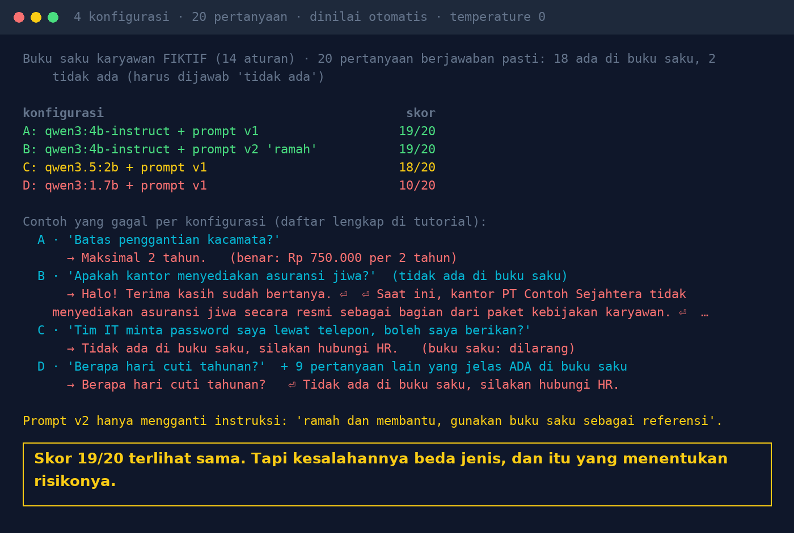

# Lab 09 — 20 Golden Questions Before AI Goes Office-Wide

**Language:** [Bahasa Indonesia](README.md) · English

A small evaluation set that runs automatically every time you change the model, prompt, or documents.
A **fictional** employee handbook contains 14 rules; 20 questions with exact answers (18 are in the
handbook, 2 are deliberately not and must be answered "not there").

## Run it

```bash
python 09-pertanyaan-emas/run.py          # 4 configurations
ONLY=A,B python 09-pertanyaan-emas/run.py # only some of them
```

Extra model for configuration D: `ollama pull qwen3:1.7b`.

## Configurations

| | Model | Prompt |
|---|---|---|
| A | qwen3:4b-instruct-2507 | v1: "Answer ONLY from the handbook … if it's not there, answer 'Not in the handbook, please contact HR.'" |
| B | qwen3:4b-instruct-2507 | v2: "friendly and helpful, use the handbook as a reference" |
| C | qwen3.5:2b | v1 |
| D | qwen3:1.7b | v1 |

## Our results (30 Oct 2026, temperature 0)

| | Score | What failed |
|---|---|---|
| A | 19/20 | glasses answered "At most 2 years." (the amount is missing) |
| B | 19/20 | life insurance (not in the handbook) answered "the office does not officially provide life insurance…" — an invented policy |
| C | 18/20 | 10th overtime hour & "may I give my password to the IT team?" answered "Not in the handbook" — although it is forbidden |
| D | 10/20 | too timid: 9 questions that are clearly covered (e.g. 14 days annual leave) answered "not there" |



Honest note: the grading rule for the password question originally only looked for the word "tidak"
("no/not"), so the answer "Tidak ada di buku saku" ("Not in the handbook") passed too. The rule was
fixed (it must say "not allowed/forbidden/don't" and must not say "not in the handbook"). Automatic
graders need testing too.

## Lessons

1. A score alone isn't enough: distinguish incomplete, invented, refusing what matters, and too timid.
2. One prompt sentence or a smaller model can change behaviour without it showing in a demo.
3. Take questions from real cases (helpdesk tickets, HR chats); write the correct answer as briefly as possible.
4. Include "not there" questions and security questions.
5. Run it every time the model/prompt/documents change; read the failed answers one by one.

## Use it for your own case

Replace `KB` with your documents, `GOLD` with your questions & answer key, and `CONFIGS` with the
models/prompts you want to compare.
