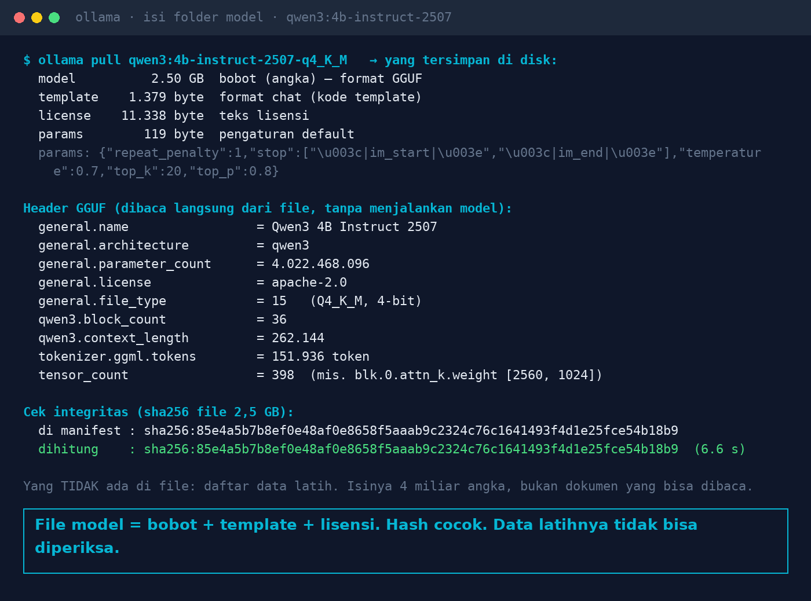
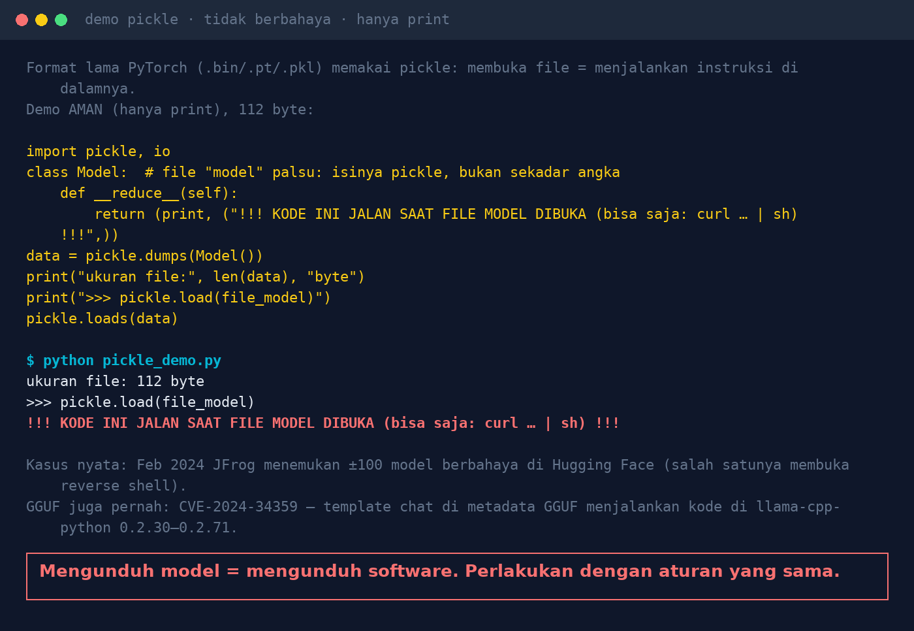

# Lab 10 — You Downloaded an AI Model. What's Actually Inside the File?

**Language:** [Bahasa Indonesia](README.md) · English

Taking an Ollama model apart without running it, then a demo of why older pickle-based model formats
are dangerous.

## Step 1 — Take the model apart

Run on the machine where Ollama is installed (needs read access to the model folder):

```bash
python 10-isi-file-model/inspect_model.py qwen3:4b-instruct-2507-q4_K_M
# different model folder?  OLLAMA_MODELS=/usr/share/ollama/.ollama/models python ...
```

Our result:

| Layer | Size | Contents |
|---|---|---|
| model | 2.50 GB | weights, GGUF format |
| template | 1,379 bytes | chat-format template |
| license | 11,338 bytes | Apache 2.0 |
| params | 119 bytes | `temperature 0.7, top_k 20, top_p 0.8, …` |

GGUF header: `Qwen3 4B Instruct 2507`, 4,022,468,096 parameters, 36 layers, `file_type 15` (Q4_K_M,
4-bit), 151,936 tokens. The sha256 was recomputed (6.6 s) and matches the manifest.



A matching hash only proves the file isn't corrupted/changed compared with the manifest — **not** that
the model is safe or comes from its original author. And there is no list of training data inside the
file.

## Step 2 — Why pickle is dangerous (safe demo)

```bash
python 10-isi-file-model/pickle_demo.py
```

A 112-byte "model" file that immediately runs `print()` when opened with `pickle.load`. In a malicious
file, `print` is replaced with any command at all.



Real cases:

- Feb 2024: JFrog found ±100 malicious models on Hugging Face, one of them opening a reverse shell
  ([Dark Reading](https://www.darkreading.com/application-security/hugging-face-ai-platform-100-malicious-code-execution-models)).
- [CVE-2024-34359](https://nvd.nist.gov/vuln/detail/CVE-2024-34359): the chat template in GGUF
  metadata could execute code in llama-cpp-python 0.2.30–0.2.71 (fixed in 0.2.72).
- PyTorch 2.6 changed the `torch.load` default to `weights_only=True` for the same reason.

## Lessons

1. Download from official sources; record the version and its hash.
2. Prefer data-only formats (safetensors, GGUF); avoid pickle from unknown sources.
3. Pin model versions; changing models = a new release that is retested.
4. Update runtimes (Ollama, llama.cpp, PyTorch) like any other software.
5. Run models on an isolated server with minimal network access.
6. Read the license before commercial use.
