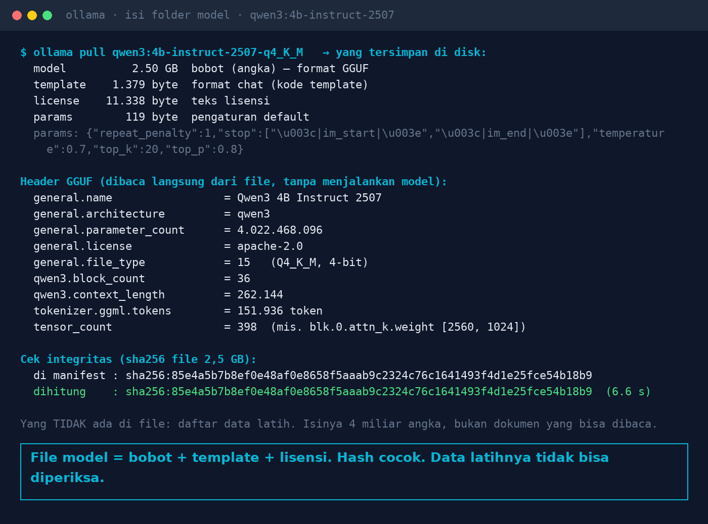
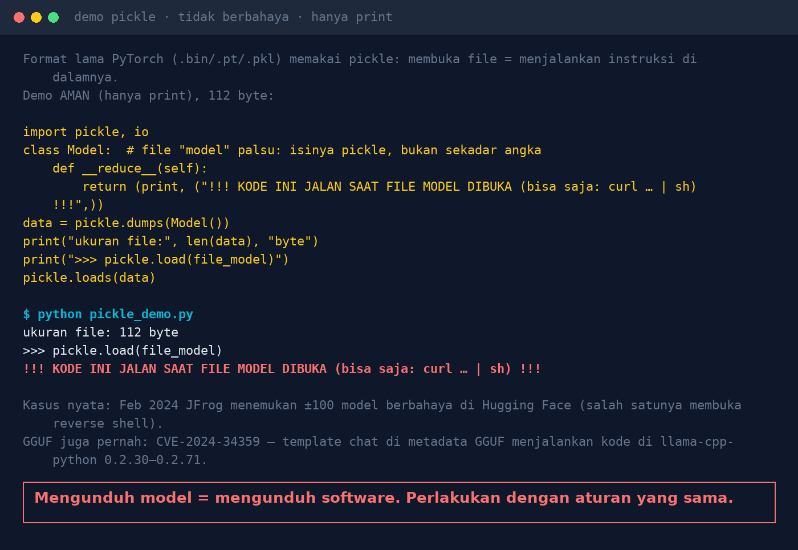

# Lab 10 — Anda Mengunduh Model AI. Apa Sebenarnya Isi File Itu?

Membongkar model Ollama tanpa menjalankannya, lalu demo kenapa format model lama berbasis pickle
berbahaya.

## Langkah 1 — Bongkar isi model

Jalankan di mesin tempat Ollama terpasang (perlu akses baca ke folder model):

```bash
python 10-isi-file-model/inspect_model.py qwen3:4b-instruct-2507-q4_K_M
# folder model berbeda?  OLLAMA_MODELS=/usr/share/ollama/.ollama/models python ...
```

Hasil kami:

| Lapisan | Ukuran | Isi |
|---|---|---|
| model | 2,50 GB | bobot, format GGUF |
| template | 1.379 byte | template format chat |
| license | 11.338 byte | Apache 2.0 |
| params | 119 byte | `temperature 0.7, top_k 20, top_p 0.8, …` |

Header GGUF: `Qwen3 4B Instruct 2507`, 4.022.468.096 parameter, 36 lapisan, `file_type 15`
(Q4_K_M, 4-bit), 151.936 token. sha256 dihitung ulang (6,6 s) dan cocok dengan manifest.



Hash yang cocok hanya membuktikan file tidak rusak/berubah dibanding manifest, **bukan** bahwa
modelnya aman atau dari pembuat aslinya. Dan tidak ada daftar data latih di dalam file.

## Langkah 2 — Kenapa pickle berbahaya (demo aman)

```bash
python 10-isi-file-model/pickle_demo.py
```

File "model" 112 byte yang langsung menjalankan `print()` saat dibuka dengan `pickle.load`. Pada
file berbahaya, `print` diganti perintah apa pun.



Kasus nyata:

- Feb 2024: JFrog menemukan ±100 model berbahaya di Hugging Face, salah satunya membuka reverse shell
  ([Dark Reading](https://www.darkreading.com/application-security/hugging-face-ai-platform-100-malicious-code-execution-models)).
- [CVE-2024-34359](https://nvd.nist.gov/vuln/detail/CVE-2024-34359): template chat di metadata GGUF
  dapat menjalankan kode di llama-cpp-python 0.2.30–0.2.71 (diperbaiki 0.2.72).
- PyTorch 2.6 mengubah default `torch.load` menjadi `weights_only=True` untuk alasan yang sama.

## Pelajaran

1. Unduh dari sumber resmi, catat versi dan hash-nya.
2. Utamakan format data-only (safetensors, GGUF); hindari pickle dari sumber tak dikenal.
3. Pin versi model; ganti model = rilis baru yang diuji ulang.
4. Perbarui runtime (Ollama, llama.cpp, PyTorch) seperti software lain.
5. Jalankan model di server terisolasi dengan akses jaringan minimal.
6. Baca lisensinya sebelum dipakai komersial.
