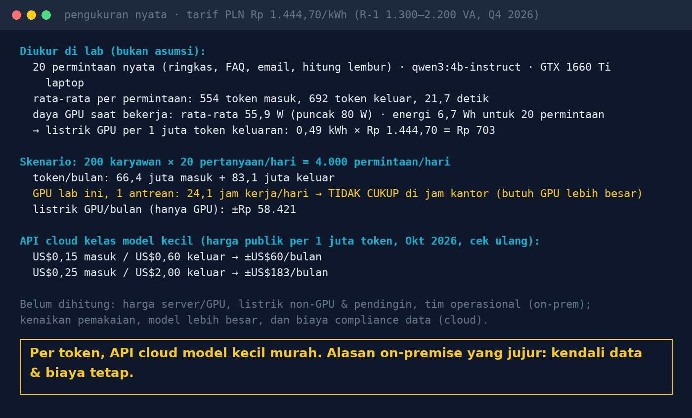

# Lab 11 — AI Costs: Cloud Token Bills vs a GPU in Your Own Server

**Language:** [Bahasa Indonesia](README.md) · English

Measure it yourself instead of assuming: tokens per request, processing time, and GPU power from 20
real requests, then project them onto your office's scenario.

## Run it (on the machine with the GPU, so `nvidia-smi` can be read)

```bash
python 11-biaya-token-vs-gpu/run.py
USERS=500 Q_PER_DAY=10 TARIF_KWH=1114.74 python 11-biaya-token-vs-gpu/run.py
```

| Env | Default | Meaning |
|---|---|---|
| `MODEL` | qwen3:4b-instruct-2507-q4_K_M | the model being measured |
| `USERS`, `Q_PER_DAY` | 200, 20 | usage scenario |
| `TARIF_KWH` | 1444.70 | Rp/kWh (Indonesian PLN tariff R-1 1,300–2,200 VA, Q4 2026); adjust to your tariff |

The cloud API prices in the script (`PRICES`) are only examples from a public price tracker as of Oct
2026; check the vendor's official prices before relying on them.

## Our results (30 Oct 2026, GTX 1660 Ti laptop)

- Per request: 554 input tokens, 692 output tokens, 21.7 seconds.
- GPU power while working ±56 W → 0.49 kWh per 1 million output tokens ≈ Rp 700 (GPU only).
- Scenario of 200 users × 20 questions/day: 66.4 million input + 83.1 million output tokens per month.
  - This GPU, processing sequentially: 24.1 hours/day → not enough for office hours.
  - GPU electricity ±Rp 58 thousand/month.
  - Cloud API for a small model: ±US$60 – US$183/month.



The figures above were measured with the full handbook (14 rules) as context. This script uses a
shorter version, so tokens per request and timing will differ. Example run of this script on the same
machine: 250 input tokens, 955 output tokens, 36.6 s per request. What matters is the method: measure
with requests that resemble your own usage.

## The honest conclusion

Per token, cloud APIs for small models are cheap. The biggest on-premise costs are hardware,
operations, and peak-hour capacity, not electricity. The strong reasons to choose on-premise are
usually: data never leaves (regulation), fixed costs, no dependence on vendor changes, the ability to
run on a closed network, and models that can be audited and version-pinned.

## Notes

- Only GPU power is measured, not the whole server/cooling.
- "Sequentially" = requests processed one at a time. Ollama can process in parallel
  (`OLLAMA_NUM_PARALLEL`); measure again under parallel load for real capacity.
