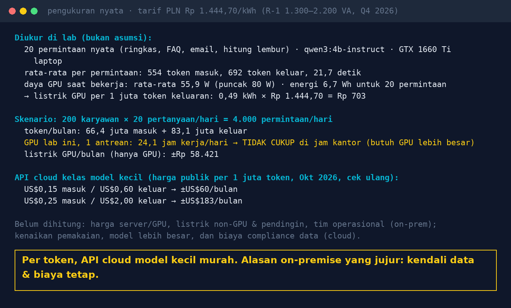

# Lab 11 — Biaya AI: Tagihan Token Cloud vs GPU di Server Sendiri

Ukur sendiri, jangan pakai asumsi: token per permintaan, waktu proses, dan daya GPU dari 20
permintaan nyata, lalu proyeksikan ke skenario kantor Anda.

## Jalankan (di mesin yang ada GPU-nya, supaya `nvidia-smi` terbaca)

```bash
python 11-biaya-token-vs-gpu/run.py
USERS=500 Q_PER_DAY=10 TARIF_KWH=1114.74 python 11-biaya-token-vs-gpu/run.py
```

| Env | Default | Arti |
|---|---|---|
| `MODEL` | qwen3:4b-instruct-2507-q4_K_M | model yang diukur |
| `USERS`, `Q_PER_DAY` | 200, 20 | skenario pemakaian |
| `TARIF_KWH` | 1444.70 | Rp/kWh (PLN R-1 1.300–2.200 VA, Q4 2026); sesuaikan golongan Anda |

Harga API cloud di script (`PRICES`) hanya contoh dari tracker harga publik per Okt 2026; cek harga
resmi vendor sebelum dipakai.

## Hasil kami (30 Okt 2026, GTX 1660 Ti laptop)

- Per permintaan: 554 token masuk, 692 token keluar, 21,7 detik.
- Daya GPU saat bekerja ±56 W → 0,49 kWh per 1 juta token keluaran ≈ Rp 700 (GPU saja).
- Skenario 200 user × 20 pertanyaan/hari: 66,4 juta token masuk + 83,1 juta keluar per bulan.
  - GPU ini, diproses berurutan: 24,1 jam/hari → tidak cukup untuk jam kantor.
  - Listrik GPU ±Rp 58 ribu/bulan.
  - API cloud model kecil: ±US$60 – US$183/bulan.



## Kesimpulan yang jujur

Per token, API cloud untuk model kecil itu murah. Biaya terbesar on-premise ada di hardware,
operasional, dan kapasitas jam sibuk, bukan listrik. Alasan kuat memilih on-premise biasanya:
data tidak keluar (regulasi), biaya tetap, tidak bergantung perubahan vendor, bisa jalan di
jaringan tertutup, dan model bisa diaudit & di-pin versinya.

## Catatan

- Daya yang diukur hanya GPU, bukan seluruh server/pendingin.
- "Berurutan" = satu permintaan diproses satu per satu. Ollama bisa memproses paralel
  (`OLLAMA_NUM_PARALLEL`); ukur ulang dengan beban paralel untuk kapasitas nyata.
