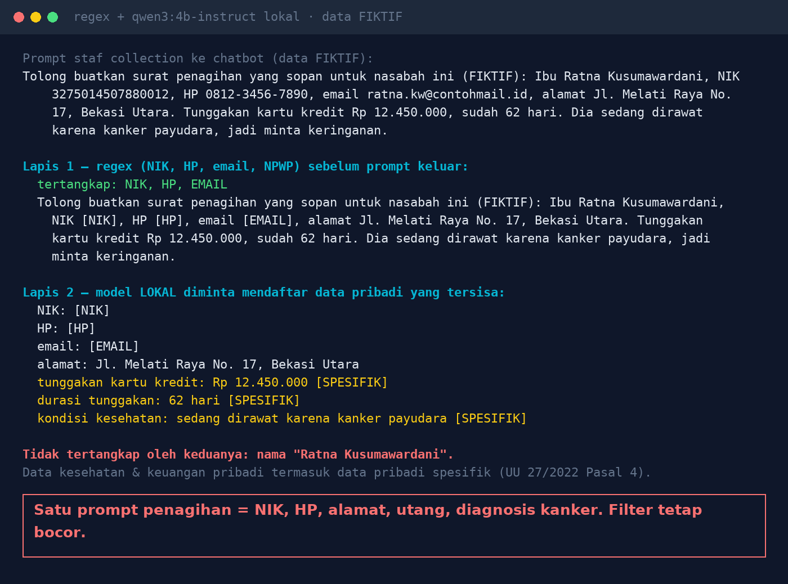

# Lab 12 — Pasting Customer Data into a Foreign Chatbot = a Cross-Border Data Transfer?

**Language:** [Bahasa Indonesia](README.md) · English

A single "write a collection letter" prompt can contain a national ID number (NIK), phone number,
address, debt, and a medical diagnosis. If it's sent to an AI service whose servers are abroad, that
is a transfer of personal data outside Indonesian jurisdiction (Law 27/2022 on Personal Data
Protection, Article 56). This lab tries two layers of filtering before a prompt leaves. The customer
data is **fictional**.

> This is not legal advice. Involve your DPO and legal team.

## Run it

```bash
python 12-data-pribadi-di-prompt/run.py
PROMPT="your own text" python 12-data-pribadi-di-prompt/run.py
```

## Our results (30 Oct 2026)

- **Layer 1 (regex)**: NIK, phone, and email masked.
- **Layer 2 (local model)**: address, arrears, arrears duration, and "treated for breast cancer"
  detected; arrears & health flagged as specific (sensitive) personal data.
- **Got past both**: the name "Ratna Kusumawardani".



## Rules summary (check the official text)

- [Law 27/2022 Article 56](https://id.wikisource.org/wiki/Halaman:UU_Nomor_27_Tahun_2022_Tentang_Perlindungan_Data_Pribadi.pdf/24):
  the receiving country must have equal or higher protection; if not, adequate & binding safeguards;
  if neither, the data subject's consent.
- [Article 57](https://pasal.id/peraturan/uu/uu-no-27-tahun-2022/pasal-57): violating Article 56
  paragraphs (2)–(4) carries administrative sanctions, with fines of up to 2% of annual revenue.
- Article 4: personal health & financial data = specific personal data.
- Government Regulation PP 33/2026 (implementing the PDP Law): full compliance by 16 January 2027.

## Lessons

1. Filters help but are never perfect; names and free-form context are the hardest to detect.
2. AI-based filters must run locally.
3. Map the AI services employees use, their server locations, and their contracts.
4. Decide which data may go into external AI; provide an internal AI for customer data.
5. Log every request to external AI.
