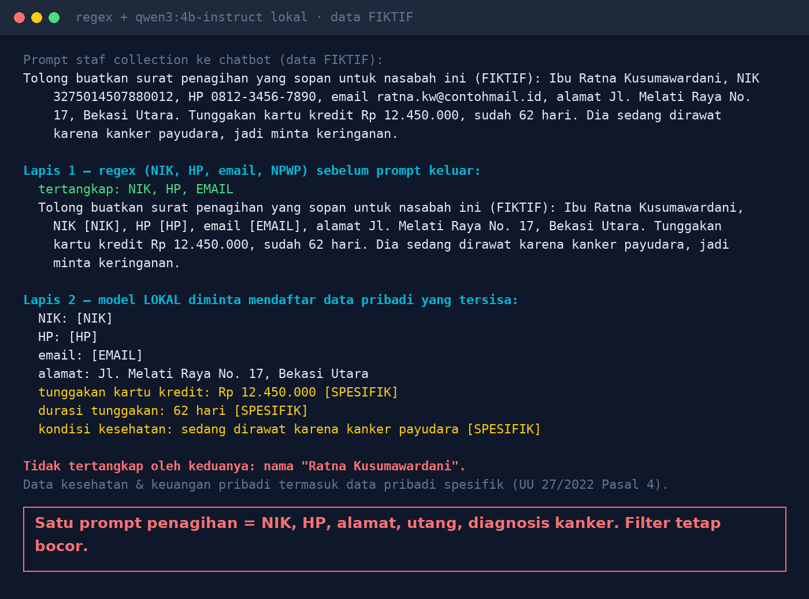

# Lab 12 — Menempel Data Pelanggan ke Chatbot Luar Negeri = Transfer Data Lintas Batas?

Satu prompt "buatkan surat penagihan" bisa berisi NIK, nomor HP, alamat, utang, dan diagnosis
penyakit. Kalau dikirim ke layanan AI yang servernya di luar negeri, itu transfer data pribadi ke
luar wilayah hukum Indonesia (UU 27/2022 Pasal 56). Lab ini mencoba dua lapis penyaring sebelum
prompt keluar. Data nasabah **fiktif**.

> Ini bukan nasihat hukum. Libatkan DPO dan tim legal Anda.

## Jalankan

```bash
python 12-data-pribadi-di-prompt/run.py
PROMPT="teks Anda sendiri" python 12-data-pribadi-di-prompt/run.py
```

## Hasil kami (30 Okt 2026)

- **Lapis 1 (regex)**: NIK, HP, email tersamarkan.
- **Lapis 2 (model lokal)**: alamat, tunggakan, durasi tunggakan, dan "dirawat karena kanker
  payudara" terdeteksi; tunggakan & kesehatan ditandai data spesifik.
- **Lolos dari keduanya**: nama "Ratna Kusumawardani".



## Ringkasan aturan (cek teks resmi)

- [UU 27/2022 Pasal 56](https://id.wikisource.org/wiki/Halaman:UU_Nomor_27_Tahun_2022_Tentang_Perlindungan_Data_Pribadi.pdf/24):
  negara penerima harus punya pelindungan setara/lebih tinggi; jika tidak, pelindungan memadai &
  mengikat; jika keduanya tidak, persetujuan subjek data.
- [Pasal 57](https://pasal.id/peraturan/uu/uu-no-27-tahun-2022/pasal-57): pelanggaran Pasal 56 ayat
  (2)–(4) dikenai sanksi administratif, denda maks 2% pendapatan tahunan.
- Pasal 4: data kesehatan & keuangan pribadi = data pribadi spesifik.
- PP 33/2026 (pelaksana UU PDP): kepatuhan penuh 16 Januari 2027.

## Pelajaran

1. Penyaring membantu, tidak pernah sempurna; nama dan konteks bebas paling sulit dideteksi.
2. Penyaring berbasis AI harus berjalan lokal.
3. Petakan layanan AI yang dipakai karyawan, lokasi server, dan kontraknya.
4. Tetapkan data apa yang boleh masuk ke AI eksternal; sediakan AI internal untuk data pelanggan.
5. Catat setiap permintaan ke AI eksternal.
