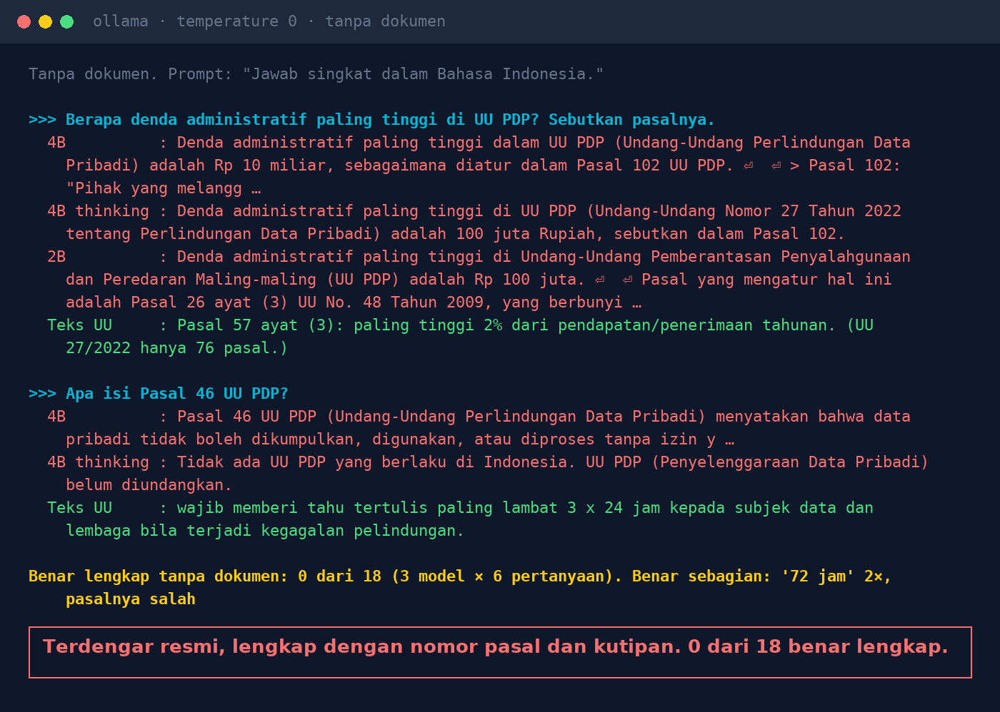
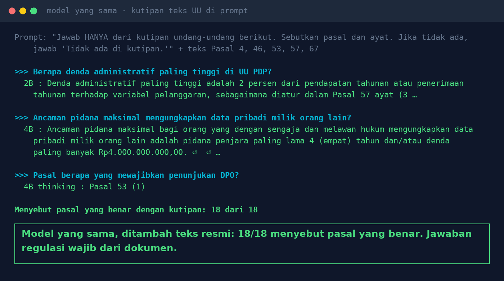

# Lab 13 — The AI Cites Legal Articles Confidently. The Articles Are Wrong.

**Language:** [Bahasa Indonesia](README.md) · English

Six questions about Indonesia's Law 27/2022 (Personal Data Protection, UU PDP) are asked to local
models twice: **without documents**, then **with the article text quoted** (Articles 4, 46, 53, 57,
67) in the system prompt.

## Run it

```bash
python 13-ai-mengutip-pasal/run.py
```

Grading is manual: compare the article numbers and the content of each answer with the official text
(e.g. [pasal.id](https://pasal.id/peraturan/uu/uu-no-27-tahun-2022)).

## Our results (31 Oct 2026, temperature 0)

**Without documents** — 0 of 18 answers (3 models × 6 questions) fully correct:

- Maximum administrative fine: "Rp 10 billion, Article 102", "Rp 100 million, Article 102", and
  "Rp 100 million, Article 26 paragraph (3) of Law No. 48 of 2009". Correct: Article 57 paragraph (3),
  at most 2% of annual revenue/income. Law 27/2022 has only 76 articles.
- Breach notification: two models answered "72 hours" (correct, 3 x 24 hours) but cited Articles 33
  and 34. The correct one is Article 46.
- One model (thinking) said the PDP Law "has not yet been enacted". The 2B model invented a law's name.



**With the article text quoted** — 18 of 18 cited the correct article, including the 2B model.



## Lessons

1. Models memorise the patterns of legal language, not the content of the articles. Answers that
   sound official are actually more dangerous.
2. Regulatory answers must come from official documents (a knowledge base), not the model's "memory".
3. Ask the AI to name the article and show the quote, so a human can check it.
4. In a real system, the quotes are fetched by retrieval. If retrieval fetches the wrong chunk, the
   answer is still wrong: see [Lab 07](../07-rag-salah-ambil/README.en.md).
5. This is not legal advice. Decisions stay with the DPO and the legal team.
