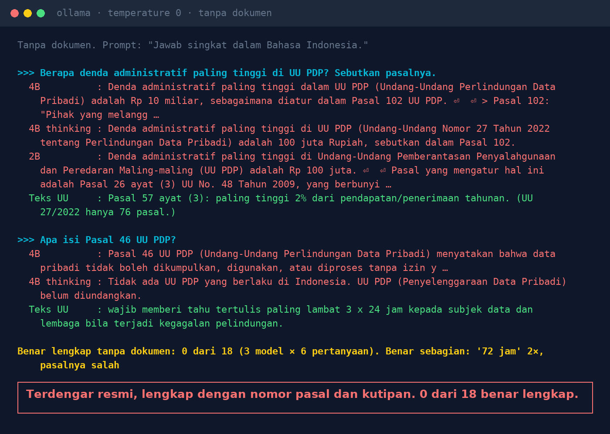
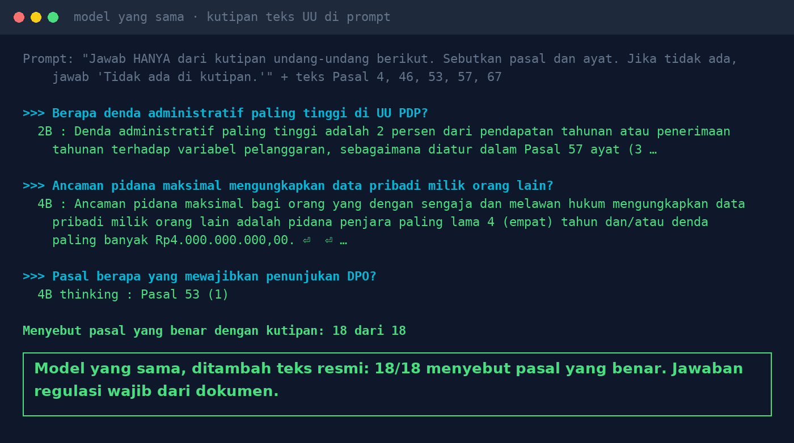

# Lab 13 — AI Mengutip Pasal dengan Yakin. Pasalnya Salah.

Enam pertanyaan tentang UU 27/2022 (Pelindungan Data Pribadi) ditanyakan ke model lokal dua kali:
**tanpa dokumen**, lalu **dengan kutipan teks pasal** (Pasal 4, 46, 53, 57, 67) di prompt sistem.

## Jalankan

```bash
python 13-ai-mengutip-pasal/run.py
```

Penilaian dilakukan manual: bandingkan nomor pasal dan isi jawaban dengan teks resmi
(misalnya [pasal.id](https://pasal.id/peraturan/uu/uu-no-27-tahun-2022)).

## Hasil kami (31 Okt 2026, temperature 0)

**Tanpa dokumen** — 0 dari 18 jawaban (3 model × 6 pertanyaan) benar lengkap:

- Denda administratif maksimal: "Rp 10 miliar, Pasal 102", "Rp 100 juta, Pasal 102", dan
  "Rp 100 juta, Pasal 26 ayat (3) UU No. 48 Tahun 2009". Yang benar: Pasal 57 ayat (3), paling
  tinggi 2% dari pendapatan/penerimaan tahunan. UU 27/2022 hanya 76 pasal.
- Notifikasi kebocoran: dua model menjawab "72 jam" (benar, 3 x 24 jam) tapi menyebut Pasal 33 dan
  Pasal 34. Yang benar Pasal 46.
- Satu model (thinking) menyebut UU PDP "belum diundangkan". Model 2B mengarang nama undang-undang.



**Dengan kutipan pasal** — 18 dari 18 menyebut pasal yang benar, termasuk model 2B.



## Pelajaran

1. Model menghafal pola bahasa hukum, bukan isi pasal. Jawaban terdengar resmi justru lebih berbahaya.
2. Jawaban regulasi wajib diambil dari dokumen resmi (knowledge base), bukan dari "ingatan" model.
3. Minta AI menyebut pasal dan menampilkan kutipannya, supaya manusia bisa mengecek.
4. Di sistem nyata, kutipan diambil oleh retrieval. Kalau retrieval salah ambil, jawaban tetap
   salah: lihat [Lab 07](../07-rag-salah-ambil/README.md).
5. Ini bukan nasihat hukum. Keputusan tetap di tangan DPO dan tim legal.
