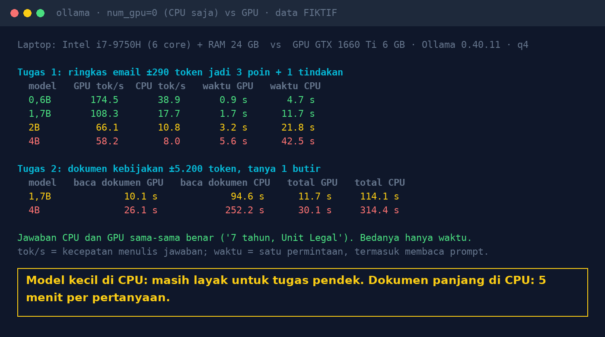

# Lab 14 — AI Without a GPU: Realistic on an Ordinary Office Server?

**Language:** [Bahasa Indonesia](README.md) · English

The same model is run twice: on the GPU, then forced onto the CPU only (Ollama option `num_gpu: 0`).
Two tasks: summarising a short email, and answering one question from a fictional policy document of
about 5,200 tokens.

## Run it

```bash
python 14-ai-tanpa-gpu/run.py
```

Extra models: `ollama pull qwen3:0.6b` and `ollama pull qwen3:1.7b`. Change the model lists with the
`MODELS` and `LONG_MODELS` env vars. With no GPU at all, the "GPU" row automatically equals the CPU row.

Measured from Ollama's response:

- `tok/s`: answer-writing speed (`eval_count / eval_duration`)
- `read prompt`: prompt-processing time (`prompt_eval_duration`)
- `total`: time for one request from the client's side

Models are loaded first with a small request, so model-loading time isn't counted.

## Our results (31 Oct 2026)

Intel i7-9750H laptop (6 cores, 24 GB RAM) vs GTX 1660 Ti 6 GB GPU, Ollama 0.40.11, 4-bit quantization.

| Model | GPU tok/s | CPU tok/s | Email: GPU | Email: CPU |
|---|---|---|---|---|
| qwen3:0.6b | 174.5 | 38.9 | 0.9 s | 4.7 s |
| qwen3:1.7b | 108.3 | 17.7 | 1.7 s | 11.7 s |
| qwen3.5:2b | 66.1 | 10.8 | 3.2 s | 21.8 s |
| qwen3:4b-instruct-2507 | 58.2 | 8.0 | 5.6 s | 42.5 s |

| Document ±5,200 tokens | Read prompt GPU | Read prompt CPU | Total GPU | Total CPU |
|---|---|---|---|---|
| qwen3:1.7b | 10.1 s | 94.6 s | 11.7 s | 114.1 s |
| qwen3:4b-instruct-2507 | 26.1 s | 252.2 s | 30.1 s | 314.4 s |

Every document answer was correct ("7 years, Legal Unit"), on both CPU and GPU.



## Lessons

1. The CPU doesn't make answers worse, only slower.
2. For long prompts, what is slow on a CPU is **reading** the prompt, not writing the answer. Shorten
   the context (take only the relevant chunks) before buying hardware.
3. Small models on a CPU are viable for trials, pilots, short tasks, and overnight batch processing.
4. A second request with exactly the same prompt is much faster because of Ollama's prompt cache.
   Measure with the first request so you aren't fooled.
5. These numbers come from a 2019 laptop CPU. Your server CPU may be very different: run this lab there.
