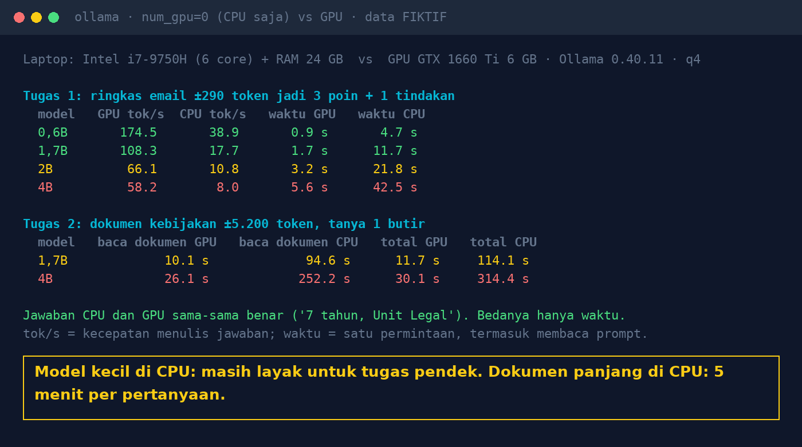

# Lab 14 — AI Tanpa GPU: Realistis di Server Kantor Biasa?

Model yang sama dijalankan dua kali: di GPU, lalu dipaksa memakai CPU saja (opsi Ollama
`num_gpu: 0`). Dua tugas: meringkas email pendek, dan menjawab satu pertanyaan dari dokumen
kebijakan fiktif sekitar 5.200 token.

## Jalankan

```bash
python 14-ai-tanpa-gpu/run.py
```

Model tambahan: `ollama pull qwen3:0.6b` dan `ollama pull qwen3:1.7b`. Ganti daftar model dengan
env `MODELS` dan `LONG_MODELS`. Tanpa GPU sama sekali, baris "GPU" otomatis sama dengan CPU.

Yang diukur dari respons Ollama:

- `tok/s`: kecepatan menulis jawaban (`eval_count / eval_duration`)
- `baca prompt`: waktu memproses prompt (`prompt_eval_duration`)
- `total`: waktu satu permintaan dari sisi klien

Model dimuat dulu dengan permintaan kecil, supaya waktu memuat model tidak ikut terhitung.

## Hasil kami (31 Okt 2026)

Laptop Intel i7-9750H (6 core, RAM 24 GB) vs GPU GTX 1660 Ti 6 GB, Ollama 0.40.11, kuantisasi 4-bit.

| Model | GPU tok/s | CPU tok/s | Email: GPU | Email: CPU |
|---|---|---|---|---|
| qwen3:0.6b | 174,5 | 38,9 | 0,9 s | 4,7 s |
| qwen3:1.7b | 108,3 | 17,7 | 1,7 s | 11,7 s |
| qwen3.5:2b | 66,1 | 10,8 | 3,2 s | 21,8 s |
| qwen3:4b-instruct-2507 | 58,2 | 8,0 | 5,6 s | 42,5 s |

| Dokumen ±5.200 token | Baca prompt GPU | Baca prompt CPU | Total GPU | Total CPU |
|---|---|---|---|---|
| qwen3:1.7b | 10,1 s | 94,6 s | 11,7 s | 114,1 s |
| qwen3:4b-instruct-2507 | 26,1 s | 252,2 s | 30,1 s | 314,4 s |

Semua jawaban dokumen benar ("7 tahun, Unit Legal"), di CPU maupun GPU.



## Pelajaran

1. CPU tidak membuat jawaban lebih buruk, hanya lebih lambat.
2. Untuk prompt panjang, yang lambat di CPU adalah **membaca** prompt, bukan menulis jawaban.
   Pendekkan konteks (ambil potongan relevan saja) sebelum membeli hardware.
3. Model kecil di CPU layak untuk uji coba, pilot, tugas pendek, dan proses batch malam hari.
4. Permintaan kedua dengan prompt yang persis sama jauh lebih cepat karena cache prompt Ollama.
   Ukur dengan permintaan pertama supaya tidak tertipu.
5. Angka ini dari CPU laptop 2019. CPU server Anda bisa jauh berbeda: jalankan lab ini di sana.
