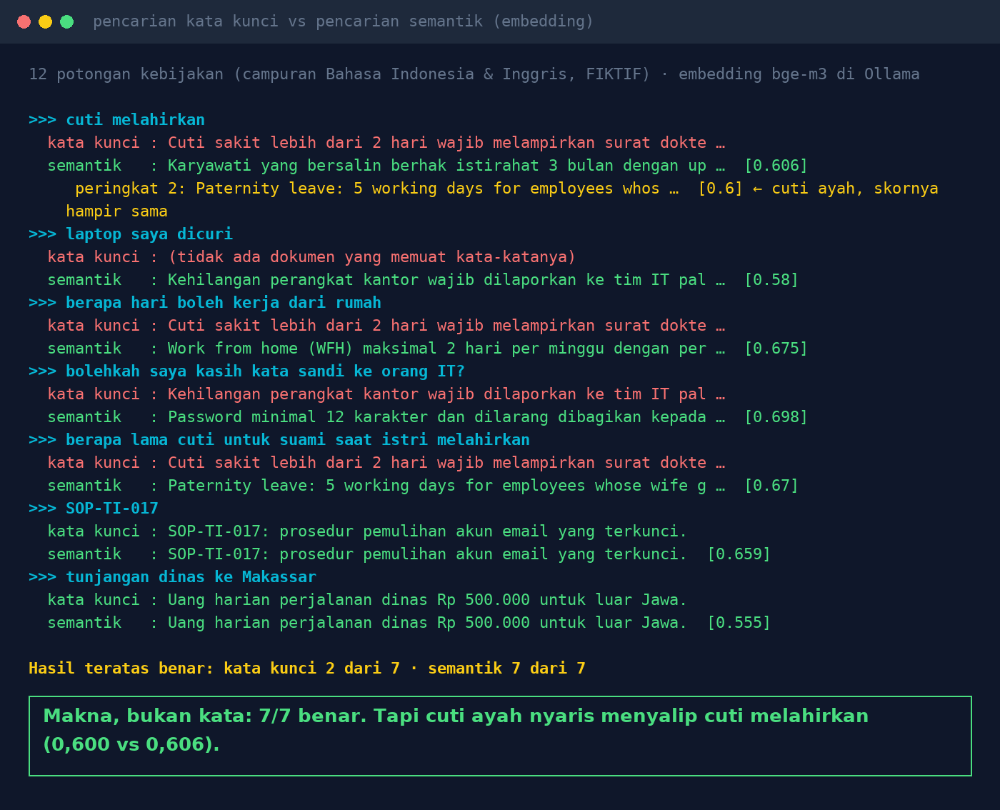

# Lab 15 — "Cuti Melahirkan" Finds "Maternity Leave": Searching for Meaning, Not Words

**Language:** [Bahasa Indonesia](README.md) · English

Two ways to search 12 fictional policy chunks (a mix of Indonesian and English):

1. **Keyword**: the document sharing the most words with the question (common words ignored)
2. **Semantic**: text is turned into vectors (embeddings) with a local model, then ranked by cosine
   similarity

## Run it

```bash
ollama pull bge-m3:567m
python 15-pencarian-makna/run.py
```

Change the embedding model: `EMBED_MODEL=nomic-embed-text python 15-pencarian-makna/run.py`.

## Our results (31 Oct 2026, bge-m3)

Correct top result: **keyword 2 of 7, semantic 7 of 7**. Queries are in Indonesian (translations in
brackets).

- "laptop saya dicuri" [my laptop was stolen] → keyword finds nothing; semantic: "Loss of office
  devices must be reported to the IT team …"
- "berapa hari boleh kerja dari rumah" [how many days can I work from home] → keyword: the sick-leave
  rule (both contain the word "hari", day); semantic: "Work from home (WFH) at most 2 days per week …"
- "SOP-TI-017" and "tunjangan dinas ke Makassar" [business-trip allowance to Makassar] → both correct.

Visible weaknesses of semantic search:

- "cuti melahirkan" [maternity leave]: rank 1 "bersalin" [childbirth leave] (0.606), rank 2
  **paternity leave** (0.600), only rank 3 "maternity leave" (0.571). Close meaning, different rule.
- Irrelevant documents still score around 0.4. Semantic search always returns something.



## Lessons

1. Semantic search finds the official term from everyday language, across languages.
2. Combine it with keywords for codes, numbers, and names (hybrid search).
3. Take the top few chunks, not one; score differences can be razor-thin.
4. Set a minimum score so that "nothing found" stays possible.
5. The keyword search in this lab is deliberately simple. Engines like BM25 with stemming are better,
   but still don't know that "stolen" and "loss of a device" are related.
