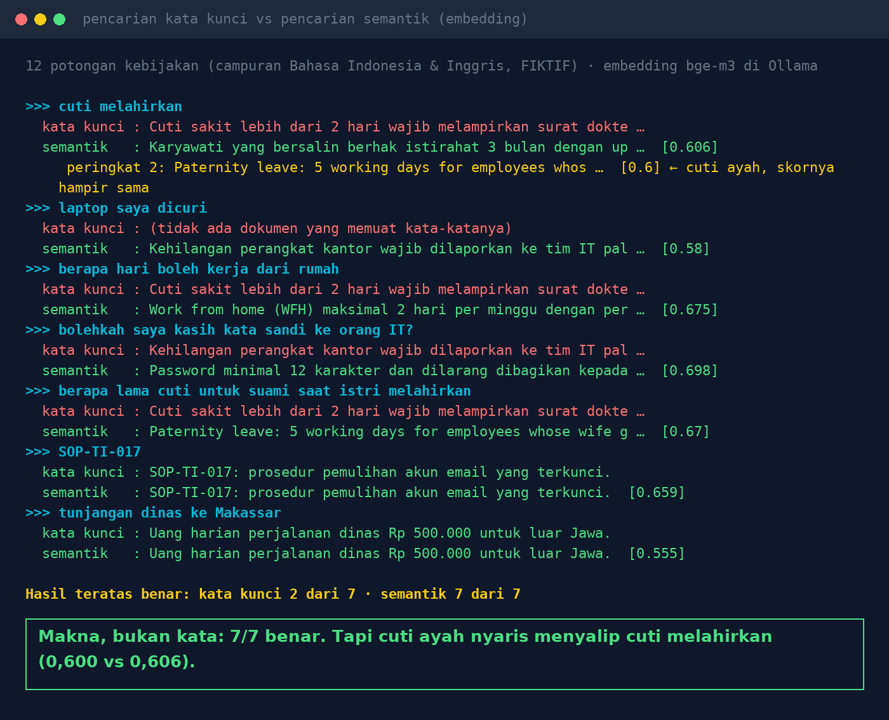

# Lab 15 — "Cuti Melahirkan" Menemukan "Maternity Leave": Mencari Makna, Bukan Kata

Dua cara mencari di 12 potongan kebijakan fiktif (campuran Bahasa Indonesia dan Inggris):

1. **Kata kunci**: dokumen dengan kata yang paling banyak sama dengan pertanyaan (kata umum diabaikan)
2. **Semantik**: teks diubah jadi vektor (embedding) dengan model lokal, lalu diurutkan berdasarkan
   kemiripan kosinus

## Jalankan

```bash
ollama pull bge-m3:567m
python 15-pencarian-makna/run.py
```

Ganti model embedding: `EMBED_MODEL=nomic-embed-text python 15-pencarian-makna/run.py`.

## Hasil kami (31 Okt 2026, bge-m3)

Hasil teratas yang benar: **kata kunci 2 dari 7, semantik 7 dari 7**.

- "laptop saya dicuri" → kata kunci tidak menemukan apa pun; semantik: "Kehilangan perangkat kantor
  wajib dilaporkan ke tim IT …"
- "berapa hari boleh kerja dari rumah" → kata kunci: aturan cuti sakit (sama-sama ada kata "hari");
  semantik: "Work from home (WFH) maksimal 2 hari per minggu …"
- "SOP-TI-017" dan "tunjangan dinas ke Makassar" → keduanya benar.

Kelemahan semantik yang terlihat:

- "cuti melahirkan": peringkat 1 "bersalin" (0,606), peringkat 2 **cuti ayah** (0,600), baru
  peringkat 3 "maternity leave" (0,571). Makna dekat, aturan berbeda.
- Dokumen yang tidak relevan tetap dapat skor sekitar 0,4. Semantik selalu mengembalikan sesuatu.



## Pelajaran

1. Semantik menemukan istilah resmi dari bahasa sehari-hari, lintas bahasa.
2. Gabungkan dengan kata kunci untuk kode, nomor, dan nama (hybrid search).
3. Ambil beberapa potongan teratas, bukan satu; selisih skor bisa sangat tipis.
4. Tetapkan skor minimum supaya "tidak ada" tetap mungkin.
5. Pencarian kata kunci di lab ini sengaja sederhana. Mesin seperti BM25 dengan stemming lebih
   baik, tapi tetap tidak tahu bahwa "dicuri" dan "kehilangan perangkat" berkaitan.
