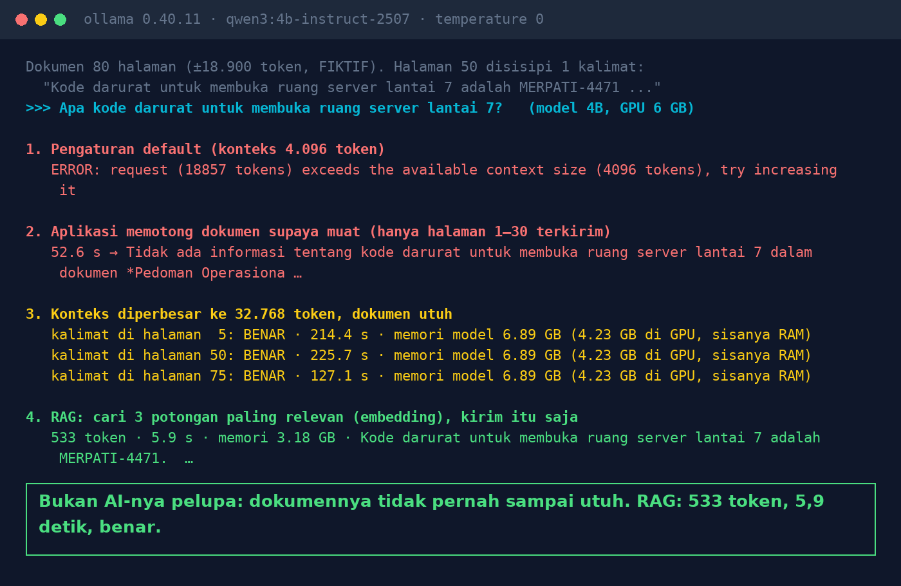

# Lab 16 — The AI "Forgets" Page 50 of an 80-Page Document

**Language:** [Bahasa Indonesia](README.md) · English

An 80-page **fictional** guideline document (±18,900 tokens). One unique sentence is inserted on a
single page: "The emergency code to open the 7th-floor server room is MERPATI-4471". Then it is asked
about in four ways.

## Run it

```bash
ollama pull bge-m3:567m
python 16-ai-lupa-halaman-50/run.py
```

Experiment 3 takes several minutes on a 6 GB GPU. Lower it with `BIG_CTX=24576` if memory is short.

## Our results (31 Oct 2026, qwen3:4b-instruct-2507, GTX 1660 Ti 6 GB)

| Experiment | Result | Time | Model memory |
|---|---|---|---|
| 1. Default context (4,096 tokens) | Error: the 18,857-token request exceeds the context | – | – |
| 2. Document truncated to fit (pages 1–30) | "There is no information about an emergency code" | 52.6 s | 3.8 GB |
| 3. Context 32,768, sentence on page 5 / 50 / 75 | Correct 3/3 | 214 / 226 / 127 s | 6.9 GB (4.2 GB on GPU) |
| 4. RAG: the 3 most relevant chunks | Correct | 5.9 s | 3.2 GB |



Notes:

- Ollama 0.40.11 rejects requests that exceed the context. Other apps or versions may truncate
  silently; experiment 2 simulates that.
- In this simple test the model did **not** forget the middle when the whole document fit (no "lost
  in the middle" effect was seen). The problem is that the document doesn't arrive whole, or is too
  expensive when forced in whole.

## Lessons

1. The context window = the model's working-memory limit. Larger documents are rejected or truncated.
2. If a chatbot answers "not there", first check whether that part of the document was actually sent.
3. A large context can work, but it's expensive: time, GPU memory, and it's repeated for every question.
4. RAG sends only the relevant chunks. The risk is retrieving the wrong chunk: see
   [Lab 07](../07-rag-salah-ambil/README.en.md).
