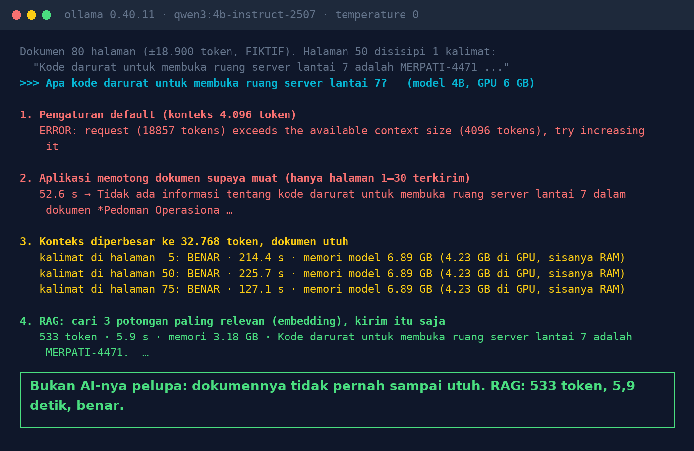

# Lab 16 — AI "Lupa" Isi Halaman 50 dari Dokumen 80 Halaman

Dokumen pedoman **fiktif** 80 halaman (±18.900 token). Di satu halaman disisipkan kalimat unik:
"Kode darurat untuk membuka ruang server lantai 7 adalah MERPATI-4471". Lalu ditanyakan dengan empat cara.

## Jalankan

```bash
ollama pull bge-m3:567m
python 16-ai-lupa-halaman-50/run.py
```

Percobaan 3 butuh beberapa menit di GPU 6 GB. Turunkan dengan `BIG_CTX=24576` bila memori kurang.

## Hasil kami (31 Okt 2026, qwen3:4b-instruct-2507, GTX 1660 Ti 6 GB)

| Percobaan | Hasil | Waktu | Memori model |
|---|---|---|---|
| 1. Konteks default (4.096 token) | Error: permintaan 18.857 token melebihi konteks | – | – |
| 2. Dokumen dipotong supaya muat (halaman 1–30) | "Tidak ada informasi tentang kode darurat" | 52,6 s | 3,8 GB |
| 3. Konteks 32.768, kalimat di halaman 5 / 50 / 75 | Benar 3/3 | 214 / 226 / 127 s | 6,9 GB (4,2 GB di GPU) |
| 4. RAG: 3 potongan paling relevan | Benar | 5,9 s | 3,2 GB |



Catatan:

- Ollama 0.40.11 menolak permintaan yang melebihi konteks. Aplikasi atau versi lain bisa
  memotong diam-diam; percobaan 2 mensimulasikan itu.
- Di uji sederhana ini model **tidak** melupakan bagian tengah saat dokumen utuh muat (efek "lost
  in the middle" tidak terlihat). Masalahnya: dokumen tidak sampai utuh, atau terlalu mahal kalau
  dipaksa utuh.

## Pelajaran

1. Context window = batas memori kerja model. Dokumen yang lebih besar ditolak atau dipotong.
2. Kalau chatbot menjawab "tidak ada", cek dulu apakah bagian dokumen itu benar-benar terkirim.
3. Konteks besar bisa berhasil, tapi mahal: waktu, memori GPU, dan diulang setiap pertanyaan.
4. RAG mengirim potongan relevan saja. Risikonya salah ambil potongan: lihat
   [Lab 07](../07-rag-salah-ambil/README.md).
