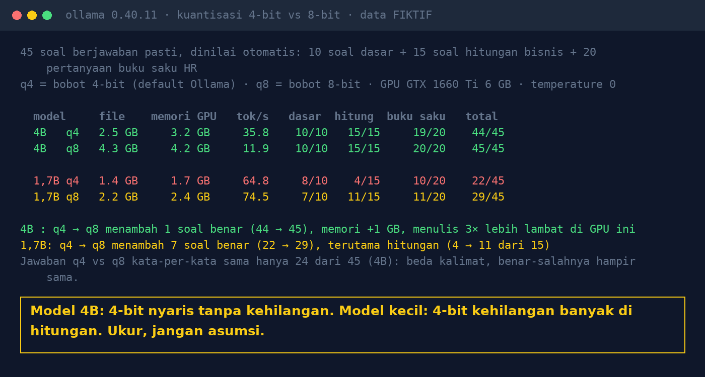

# Lab 17 — 4-bit Models: Memory-Efficient, but Dumber?

**Language:** [Bahasa Indonesia](README.md) · English

The same model in two quantization versions (4-bit `q4_K_M` and 8-bit `q8_0` weights) is tested with
45 questions with exact answers, graded automatically:

- 10 basic questions from [Lab 04](../04-ukuran-model/README.en.md) (logic, extraction, SQL, JSON)
- 15 business-arithmetic questions (discount + VAT, compound interest, penalties, exchange rate +
  import duty, comparisons)
- 20 fictional HR-handbook questions from [Lab 09](../09-pertanyaan-emas/README.en.md)

## Run it

```bash
ollama pull qwen3:4b-instruct-2507-q8_0   # 4.3 GB
ollama pull qwen3:1.7b                    # 1.4 GB (q4_K_M)
ollama pull qwen3:1.7b-q8_0               # 2.2 GB
python 17-kuantisasi-4bit/run.py
```

## Our results (31 Oct 2026, GTX 1660 Ti 6 GB, temperature 0)

| Model | File | GPU memory | tok/s | Basic | Arithmetic | Handbook | Total |
|---|---|---|---|---|---|---|---|
| 4B q4 | 2.5 GB | 3.2 GB | 35.8 | 10/10 | 15/15 | 19/20 | **44/45** |
| 4B q8 | 4.3 GB | 4.2 GB | 11.9 | 10/10 | 15/15 | 20/20 | **45/45** |
| 1.7B q4 | 1.4 GB | 1.7 GB | 64.8 | 8/10 | 4/15 | 10/20 | **22/45** |
| 1.7B q8 | 2.2 GB | 2.4 GB | 74.5 | 7/10 | 11/15 | 11/20 | **29/45** |

- 4B: a difference of only 1 question (the glasses reimbursement limit). The answers were word-for-word
  identical on 24 of 45 questions.
- 1.7B: 8-bit is much better at arithmetic (4 → 11 of 15).
- Speed (tok/s) was affected by our GPU occasionally crashing and being retried; don't treat it as a
  benchmark.



## Lessons

1. For mid-sized models, 4-bit is usually enough: it saves memory with nearly the same quality.
2. For small models, compression can damage specific abilities, especially arithmetic.
3. Changing the quantization version = changing the model: rerun your evaluation set.
4. 45 questions, one model family, one GPU. Measure with questions from your team's own work.
