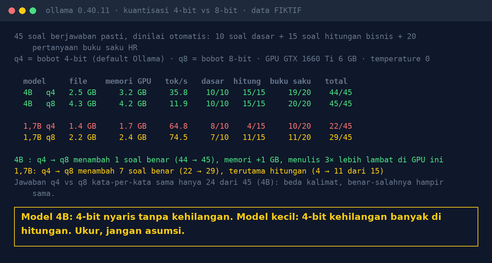

# Lab 17 — Model 4-bit: Hemat Memori, tapi Apakah Lebih Bodoh?

Model yang sama dalam dua versi kuantisasi (bobot 4-bit `q4_K_M` dan 8-bit `q8_0`) diuji dengan
45 soal berjawaban pasti, dinilai otomatis:

- 10 soal dasar dari [Lab 04](../04-ukuran-model/README.md) (logika, ekstraksi, SQL, JSON)
- 15 soal hitungan bisnis (diskon + PPN, bunga majemuk, denda, kurs + bea masuk, perbandingan)
- 20 pertanyaan buku saku HR fiktif dari [Lab 09](../09-pertanyaan-emas/README.md)

## Jalankan

```bash
ollama pull qwen3:4b-instruct-2507-q8_0   # 4,3 GB
ollama pull qwen3:1.7b                    # 1,4 GB (q4_K_M)
ollama pull qwen3:1.7b-q8_0               # 2,2 GB
python 17-kuantisasi-4bit/run.py
```

## Hasil kami (31 Okt 2026, GTX 1660 Ti 6 GB, temperature 0)

| Model | File | Memori GPU | tok/s | Dasar | Hitungan | Buku saku | Total |
|---|---|---|---|---|---|---|---|
| 4B q4 | 2,5 GB | 3,2 GB | 35,8 | 10/10 | 15/15 | 19/20 | **44/45** |
| 4B q8 | 4,3 GB | 4,2 GB | 11,9 | 10/10 | 15/15 | 20/20 | **45/45** |
| 1,7B q4 | 1,4 GB | 1,7 GB | 64,8 | 8/10 | 4/15 | 10/20 | **22/45** |
| 1,7B q8 | 2,2 GB | 2,4 GB | 74,5 | 7/10 | 11/15 | 11/20 | **29/45** |

- 4B: selisih hanya 1 soal (batas penggantian kacamata). Jawaban kata-per-kata sama di 24 dari 45 soal.
- 1,7B: 8-bit jauh lebih baik di hitungan (4 → 11 dari 15).
- Kecepatan (tok/s) dipengaruhi GPU kami yang sesekali crash dan di-retry; jangan dijadikan patokan.



## Pelajaran

1. Untuk model menengah, 4-bit biasanya cukup: hemat memori, kualitas nyaris sama.
2. Untuk model kecil, kompresi bisa merusak kemampuan tertentu, terutama hitungan.
3. Ganti versi kuantisasi = ganti model: jalankan ulang set evaluasi Anda.
4. 45 soal, satu keluarga model, satu GPU. Ukur dengan soal dari pekerjaan tim Anda.
