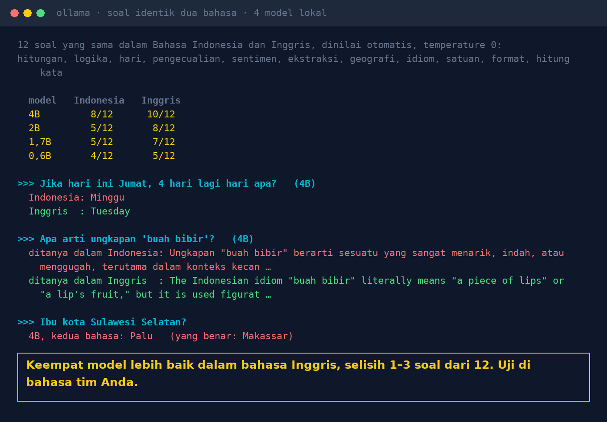

# Lab 18 — Indonesian vs English: Is Local AI Equally Smart?

**Language:** [Bahasa Indonesia](README.md) · English

The same 12 questions written in Indonesian and in English (arithmetic, percentages, logic, days,
rule exceptions, sentiment, extraction, geography, idioms, units, formatting, word counting), asked
to 4 local models and graded automatically.

## Run it

```bash
ollama pull qwen3:1.7b && ollama pull qwen3:0.6b
python 18-bahasa-indonesia-vs-inggris/run.py
```

`VERBOSE=1` shows every answer, not only the wrong ones.

## Our results (31 Oct 2026, temperature 0)

| Model | Indonesian | English |
|---|---|---|
| qwen3:4b-instruct-2507 | 8/12 | 10/12 |
| qwen3.5:2b | 5/12 | 8/12 |
| qwen3:1.7b | 5/12 | 7/12 |
| qwen3:0.6b | 4/12 | 5/12 |

- "If today is Friday, what day is it in 4 days?" → 4B in Indonesian: "Minggu" (Sunday). In English:
  "Tuesday".
- "What does 'buah bibir' mean?" (an Indonesian idiom for "the talk of the town") → asked in
  Indonesian: "something very interesting, beautiful"; asked in English: "gossip, talk", closer to the
  real meaning.
- "Capital of South Sulawesi?" → 4B answered "Palu" in both languages (correct: Makassar).



Honest notes:

- The first version of the Indonesian arithmetic question was ambiguous ("3 books costing 12,500"
  without "per book"). This script uses the corrected version; the scores above use it too.
- The word-count question uses a different sentence per language (both 6 words).
- 12 questions is a small sample. Treat it as a pattern, not a precise measurement.

## Lessons

1. Test models in the language your team and customers use, not only English-language benchmarks.
2. Include local terms: idioms, abbreviations, Indonesian date and number formats.
3. Write questions and instructions that aren't ambiguous.
4. For important tasks, take answers from documents, not from the model's general knowledge.
