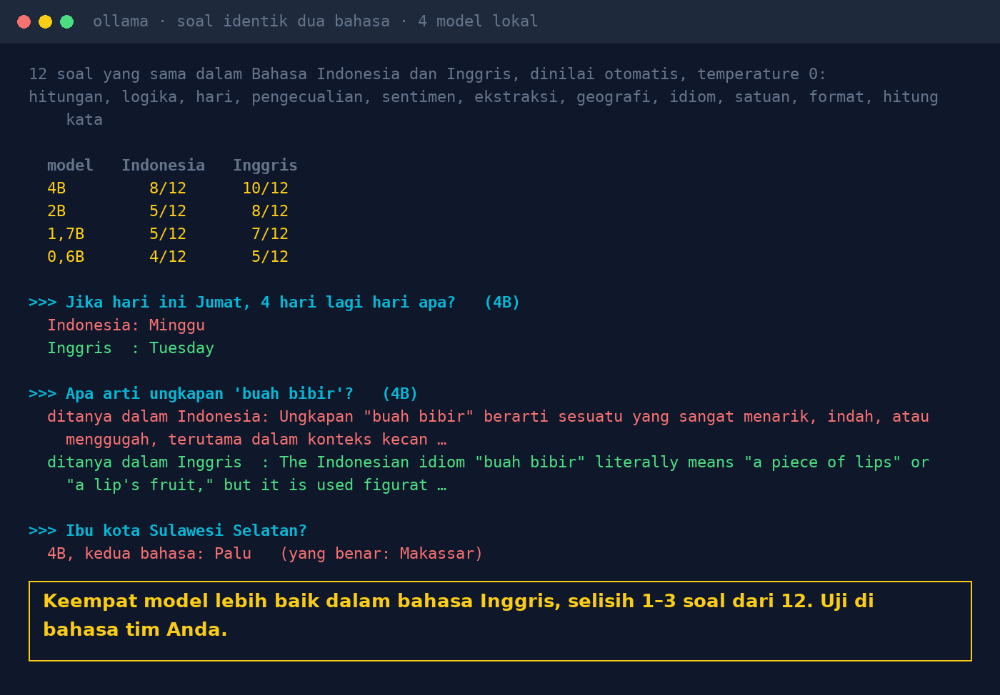

# Lab 18 — Bahasa Indonesia vs Inggris: Apakah AI Lokal Sama Pintarnya?

12 soal yang sama ditulis dalam Bahasa Indonesia dan Inggris (hitungan, persen, logika, hari,
pengecualian aturan, sentimen, ekstraksi, geografi, idiom, satuan, format, hitung kata), lalu
ditanyakan ke 4 model lokal dan dinilai otomatis.

## Jalankan

```bash
ollama pull qwen3:1.7b && ollama pull qwen3:0.6b
python 18-bahasa-indonesia-vs-inggris/run.py
```

`VERBOSE=1` menampilkan semua jawaban, bukan hanya yang salah.

## Hasil kami (31 Okt 2026, temperature 0)

| Model | Indonesia | Inggris |
|---|---|---|
| qwen3:4b-instruct-2507 | 8/12 | 10/12 |
| qwen3.5:2b | 5/12 | 8/12 |
| qwen3:1.7b | 5/12 | 7/12 |
| qwen3:0.6b | 4/12 | 5/12 |

- "Jika hari ini Jumat, 4 hari lagi hari apa?" → 4B: "Minggu". Versi Inggris: "Tuesday".
- "Arti 'buah bibir'?" → ditanya dalam Indonesia: "sesuatu yang sangat menarik, indah"; dalam
  Inggris: "gossip, talk", lebih dekat ke arti sebenarnya.
- "Ibu kota Sulawesi Selatan?" → 4B menjawab "Palu" di kedua bahasa (benar: Makassar).



Catatan jujur:

- Versi pertama soal hitungan Indonesia ambigu ("3 buku seharga 12.500" tanpa "per buku"). Script
  ini memakai versi perbaikan; skor di atas juga memakai versi perbaikan.
- Soal hitung kata memakai kalimat berbeda per bahasa (sama-sama 6 kata).
- 12 soal adalah sampel kecil. Anggap pola, bukan ukuran pasti.

## Pelajaran

1. Uji model di bahasa yang dipakai tim dan pelanggan Anda, bukan hanya benchmark berbahasa Inggris.
2. Masukkan istilah lokal: idiom, singkatan, format tanggal dan angka Indonesia.
3. Tulis soal dan instruksi yang tidak ambigu.
4. Untuk tugas penting, ambil jawaban dari dokumen, bukan dari pengetahuan umum model.
