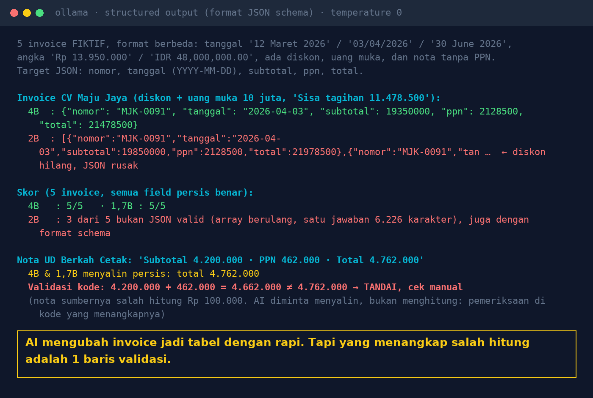

# Lab 19 — From Invoice Text to a Table: Structured Data Extraction

**Language:** [Bahasa Indonesia](README.md) · English

Five **fictional** invoice texts in different formats (Indonesian/English dates, "Rp 13.950.000" vs
"IDR 48,000,000.00", discounts, down payments, a receipt without VAT) are turned into JSON: `nomor`
(number), `tanggal` (date, YYYY-MM-DD), `subtotal`, `ppn` (VAT), `total`. The result is then validated
with business rules in code.

One receipt is deliberately **miscalculated at the source** (subtotal 4,200,000 + VAT 462,000 written
as total 4,762,000).

## Run it

```bash
python 19-invoice-ke-json/run.py
```

Two modes: instructions in the prompt only, and with the Ollama `format` parameter holding a JSON
schema (structured output).

## Our results (31 Oct 2026, temperature 0)

| Model | All fields correct (prompt only) | With schema format |
|---|---|---|
| qwen3:4b-instruct-2507 | 5/5 | 5/5 |
| qwen3:1.7b | 5/5 | 5/5 |
| qwen3.5:2b | 2/5 (3 not a JSON object) | 2/5 (3 not a JSON object) |

- The successful models read "03/04/2026" as 3 April, "IDR 48,000,000.00" as 48000000, and took the
  Grand Total, not the "Remaining balance" after the down payment.
- qwen3.5:2b returned an **array** of repeated objects (one answer was 6,226 characters), with or
  without the schema. On the discounted invoice, its subtotal and total were wrong.
- The miscalculated receipt was copied exactly by the models (they were asked to copy). The
  `validate()` function caught it: `subtotal + ppn = 4,662,000 ≠ total 4,762,000`.



## Lessons

1. AI is good at reading messy formats and filling predefined fields.
2. A schema helps, but still check: not every model/version follows it.
3. Validate business rules in code (totals, VAT, date format, duplicate numbers). Failures → human review.
4. This lab starts from text. Scanned PDFs need OCR first, and that is a separate source of errors.
