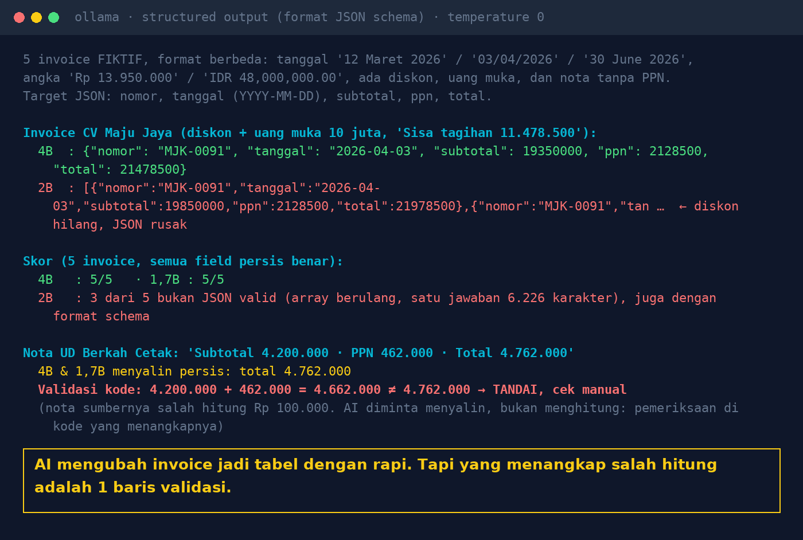

# Lab 19 — Dari Teks Invoice ke Tabel: Ekstraksi Data Terstruktur

Lima teks invoice **fiktif** dengan format berbeda (tanggal Indonesia/Inggris, "Rp 13.950.000" vs
"IDR 48,000,000.00", diskon, uang muka, nota tanpa PPN) diubah jadi JSON: `nomor`, `tanggal`
(YYYY-MM-DD), `subtotal`, `ppn`, `total`. Lalu hasilnya divalidasi dengan aturan bisnis di kode.

Satu nota sengaja **salah hitung di sumbernya** (subtotal 4.200.000 + PPN 462.000 ditulis total
4.762.000).

## Jalankan

```bash
python 19-invoice-ke-json/run.py
```

Dua mode: hanya instruksi di prompt, dan dengan parameter Ollama `format` berisi JSON schema
(structured output).

## Hasil kami (31 Okt 2026, temperature 0)

| Model | Benar semua field (prompt saja) | Dengan format schema |
|---|---|---|
| qwen3:4b-instruct-2507 | 5/5 | 5/5 |
| qwen3:1.7b | 5/5 | 5/5 |
| qwen3.5:2b | 2/5 (3 bukan JSON objek) | 2/5 (3 bukan JSON objek) |

- Model yang berhasil membaca "03/04/2026" sebagai 3 April, "IDR 48,000,000.00" sebagai 48000000,
  dan mengambil Grand Total, bukan "Sisa tagihan" setelah uang muka.
- qwen3.5:2b mengeluarkan **array** berisi objek berulang (satu jawaban 6.226 karakter), dengan
  maupun tanpa schema. Di invoice berdiskon, subtotal dan totalnya salah.
- Nota salah hitung disalin persis oleh model (memang diminta menyalin). Fungsi `validate()` yang
  menangkapnya: `subtotal + ppn = 4,662,000 ≠ total 4,762,000`.



## Pelajaran

1. AI bagus untuk membaca format berantakan dan mengisi kolom yang sudah ditentukan.
2. Schema membantu, tapi tetap periksa: tidak semua model/versi mematuhinya.
3. Validasi aturan bisnis di kode (total, PPN, format tanggal, nomor ganda). Yang gagal → review manusia.
4. Lab ini mulai dari teks. PDF hasil scan butuh OCR dulu, dan itu sumber kesalahan tersendiri.
