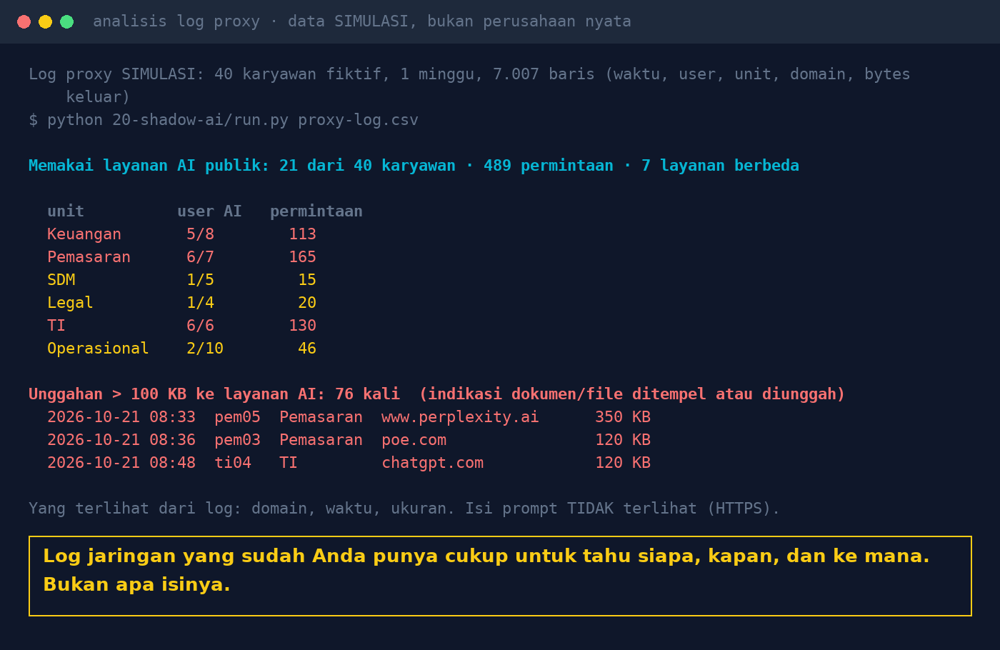

# Lab 20 — Shadow AI: Detecting Public Chatbot Use from Office Logs

**Language:** [Bahasa Indonesia](README.md) · English

A small script (Python standard library, no AI model) that reads proxy, firewall, or DNS logs and
answers: who accesses public AI services, from which unit, to which service, and when large uploads
happen (a sign that documents or files were pasted in).

## Run it

```bash
python 20-shadow-ai/run.py                  # SIMULATED log (40 fictional employees, 1 week)
python 20-shadow-ai/run.py your-log.csv     # your own log
```

- CSV format: `waktu,user,unit,domain,bytes_keluar` (time, user, unit, domain, bytes out). Column
  names can be adjusted in `COLS`.
- Extend the domain list in `AI`. Services the company has already approved:
  `APPROVED=copilot.microsoft.com python 20-shadow-ai/run.py log.csv`
- Large-upload threshold: `BIG_BYTES=50000` (default 100 KB).

## Example result (simulated log)

The figures below come from a **simulated** log generated by the script, not real company data.

- 21 of 40 employees accessed 7 public AI services, 489 requests in one week
- 76 uploads above 100 KB, mostly from the Marketing, IT, and Finance units



## Public data on shadow AI

- Microsoft & LinkedIn [Work Trend Index 2024](https://blogs.microsoft.com/blog/2024/05/08/microsoft-and-linkedin-release-the-2024-work-trend-index-on-the-state-of-ai-at-work/):
  75% of knowledge workers use AI at work; 78% of AI users bring their own tools.
- Samsung, April 2023: internal source code was uploaded to a public chatbot; in May 2023 generative
  AI was banned on company devices and networks ([CSO Online](https://www.csoonline.com/article/3695170/samsung-bans-staff-ai-use-over-data-leak-concerns.html)).
- [IBM Cost of a Data Breach 2025](https://www.ibm.com/think/x-force/2025-cost-of-a-data-breach-navigating-ai):
  20% of organisations experienced a breach related to shadow AI; it added US$670 thousand on average
  to the cost.

## Lessons

1. The logs you already have are enough to know who, when, where, and how much. Prompt contents are
   not visible (HTTPS); don't promise more.
2. Measure first, then write a policy. Ask the most active units: what tasks does AI help them with?
3. Blocking without an alternative just moves usage to personal phones. Provide a safe internal AI.
4. Use this script only on logs your own organisation owns, in line with the applicable employee
   monitoring policy.
