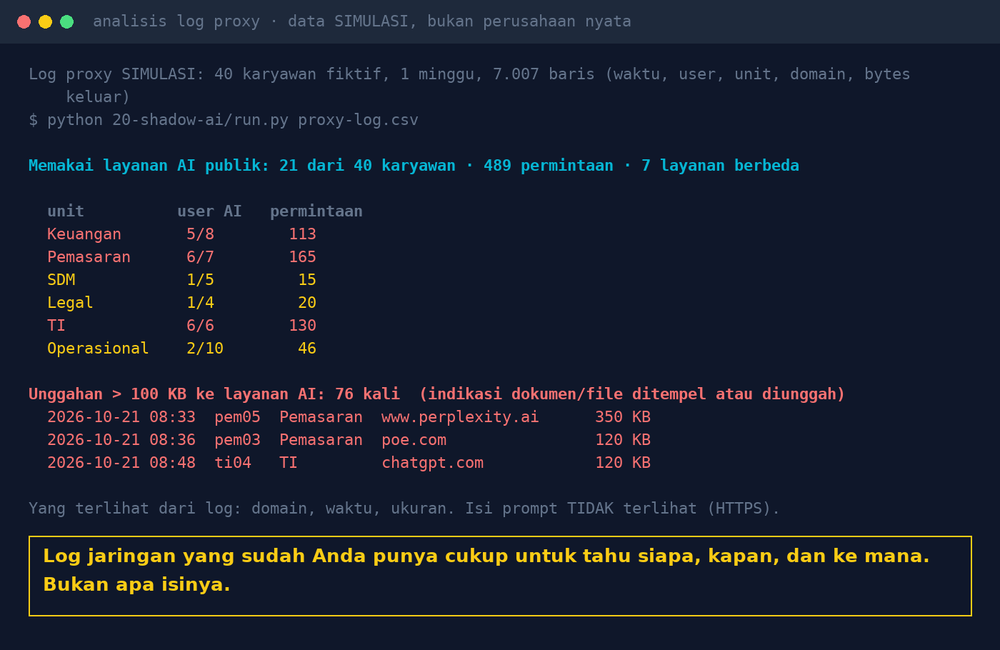

# Lab 20 — Shadow AI: Mendeteksi Pemakaian Chatbot Publik dari Log Kantor

Script kecil (Python standard library, tanpa model AI) yang membaca log proxy, firewall, atau DNS
dan menjawab: siapa yang mengakses layanan AI publik, dari unit mana, ke layanan apa, dan kapan ada
unggahan besar (indikasi dokumen atau file ditempel).

## Jalankan

```bash
python 20-shadow-ai/run.py                  # log SIMULASI (40 karyawan fiktif, 1 minggu)
python 20-shadow-ai/run.py log-anda.csv     # log Anda sendiri
```

- Format CSV: `waktu,user,unit,domain,bytes_keluar`. Nama kolom bisa disesuaikan di `COLS`.
- Lengkapi daftar domain di `AI`. Layanan yang sudah disetujui perusahaan:
  `APPROVED=copilot.microsoft.com python 20-shadow-ai/run.py log.csv`
- Ambang unggahan besar: `BIG_BYTES=50000` (default 100 KB).

## Contoh hasil (log simulasi)

Angka di bawah dari log **simulasi** yang dibangkitkan script, bukan data perusahaan nyata.

- 21 dari 40 karyawan mengakses 7 layanan AI publik, 489 permintaan dalam seminggu
- 76 unggahan di atas 100 KB, terbanyak dari unit Pemasaran, TI, dan Keuangan



## Data publik tentang shadow AI

- Microsoft & LinkedIn [Work Trend Index 2024](https://blogs.microsoft.com/blog/2024/05/08/microsoft-and-linkedin-release-the-2024-work-trend-index-on-the-state-of-ai-at-work/):
  75% knowledge worker memakai AI di tempat kerja; 78% dari pengguna AI membawa tool sendiri.
- Samsung, April 2023: source code internal diunggah ke chatbot publik; Mei 2023 AI generatif
  dilarang di perangkat dan jaringan perusahaan ([CSO Online](https://www.csoonline.com/article/3695170/samsung-bans-staff-ai-use-over-data-leak-concerns.html)).
- [IBM Cost of a Data Breach 2025](https://www.ibm.com/think/x-force/2025-cost-of-a-data-breach-navigating-ai):
  20% organisasi mengalami kebocoran terkait shadow AI; menambah rata-rata US$670 ribu biaya.

## Pelajaran

1. Log yang sudah ada cukup untuk tahu siapa, kapan, ke mana, dan seberapa besar. Isi prompt
   tidak terlihat (HTTPS); jangan menjanjikan lebih.
2. Ukur dulu, baru buat kebijakan. Tanyakan ke unit yang paling aktif: tugas apa yang dibantu AI?
3. Blokir tanpa alternatif hanya memindahkan pemakaian ke HP pribadi. Sediakan AI internal yang aman.
4. Pakai script ini hanya pada log milik organisasi Anda sendiri, sesuai kebijakan pemantauan
   karyawan yang berlaku.
